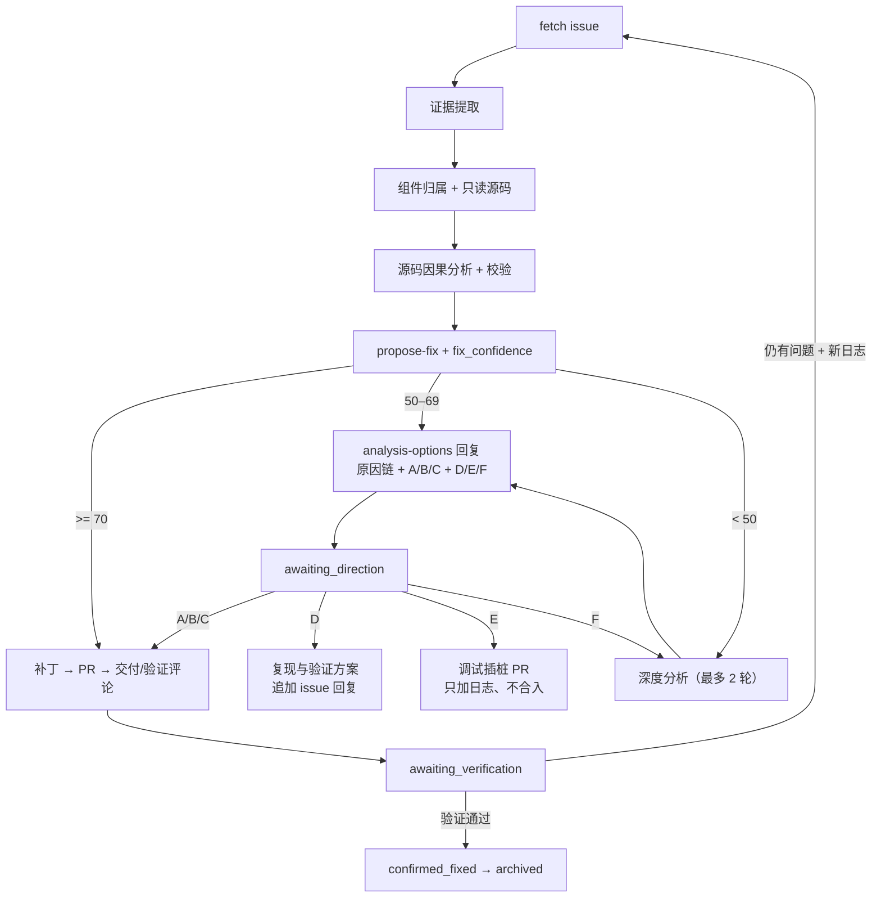

# OpenFDE Issue AI Assistant

面向 OpenFDE 的 issue 分析与修复工作流助手：从 GitHub 读取 issue、评论与附件，基于 `fde-manifests` 和只读源码树做源码级因果分析，按修复置信度分流——高置信直接产出修复 PR，中低置信先产出“原因链 + 修复选项”的 issue 回复，必要时提供复现方案或调试插桩 PR。

> 全流程以“未验证建议”为边界：不修改只读源码树、不自动合入 PR、不关闭 issue；所有补丁、PR 与结论均标注 `not_run` / 未验证，由开发人员审阅与验证。

## 快速开始

**交互式（推荐，本机/已有源码树）**

```sh
git clone git@src.ift.run:ai-apps/fde-ai-assistant.git
cd fde-ai-assistant
# 准备 fde-manifests/ 与 fde-sources/（见第 3 节）
gh auth login -h github.com
export DEEPSEEK_API_KEY='...'
pi
```

```text
/skill:run-issue-workflow 使用 profiles/openfde/profile.json 分析问题 <编号>
```

**Docker 一键（Linux + Docker Compose，不需要 AOSP 构建）**

```sh
cp deploy/server/env.example .env    # 填 GH_TOKEN / DEEPSEEK_API_KEY
./deploy/docker/up.sh                # 首次自动同步所需源码模块
docker compose exec scanner pi       # 等 sources-sync 完成后交互式使用
```

## 目录

- [1. 能力与边界](#1-能力与边界)
- [2. 工作流一览](#2-工作流一览)
- [3. 从代码获取](#3-从代码获取)
- [4. 安装](#4-安装)
- [5. 使用配置](#5-使用配置)
- [6. 各环节任务命令](#6-各环节任务命令)
- [7. 执行过程](#7-执行过程)
- [8. 目录结构](#8-目录结构)
- [9. 常见问题](#9-常见问题)
- [10. 文档索引](#10-文档索引)

## 1. 能力与边界

**做什么**

- 拉取 issue、评论与附件元数据，按证据条件提取日志/文本证据；
- 按三层归属定位组件（组件映射知识 → 本地源码树信号 → manifest 结构）；
- 在只读 `fde-sources/` 中追溯源码，输出可审计的原因链、修复选项与验证判据；
- 修复置信度 ≥70 时生成未验证补丁与 GitHub PR（只创建、不合入）；
- 置信度不足时生成 `analysis-options` issue 回复（原因链 + 修复选项 + 复现方案/调试 PR/深入分析选项）；
- 轮询 issue 回复，按开发选择继续修复、展开复现方案、创建调试插桩 PR 或重新分析。

**不做什么**

- 不修改 `fde-sources/` 只读树；不在设备上执行写操作（root、清日志、改设置、输入注入）；
- 不自动合入/关闭 PR，不关闭 issue；
- 不把补丁、PR 或 AI 分析声称为“已验证”；
- 不在 issue、JSON、日志或代码中写入任何凭据；
- 默认不构建（`build.enabled=false`）；构建通道只能由授权助手在受控构建树内临时应用补丁并在退出前回滚。

## 2. 工作流一览



**置信度分流**

| `fix_confidence` | 处理 |
| --- | --- |
| ≥ 70 | 修复助手：补丁 → PR（人工确认）→ 交付/验证征询评论 → `awaiting_verification` |
| 50–69 | 分析助手：生成 `analysis-options` 草案（原因链 + A/B/C + D/E/F），确认后发布 → `awaiting_direction` |
| < 50 | 分析助手深度分析（最多 2 轮）；仍不足则发调查选项 → `awaiting_direction` |

`fix_confidence = min(根因置信度, 修复置信度)`，记录在 `solution/solution.json`；分层锚点见 [Pi 使用指南](docs/guides/pi-usage.md#置信度分流分析助手--修复助手)。

## 3. 从代码获取

### 3.1 助手仓库

```sh
git clone git@src.ift.run:ai-apps/fde-ai-assistant.git
cd fde-ai-assistant
```

主仓库只包含工作流代码、skills、profile、部署脚本与测试；以下目录通过 `.gitignore` 排除，需要单独准备：

```text
fde-manifests/   # Android repo 清单（必需）
fde-sources/     # 只读源码树（必需）
fde-build/       # 可写构建树（仅构建通道需要）
data/            # 运行数据、知识库、日志（自动生成）
.fde-ai/         # issue 工件（自动生成）
```

### 3.2 清单：fde-manifests

```sh
git clone https://src.ift.run/openfde17/fde-manifests fde-manifests
```

确认 `fde-manifests/default.xml` 与 `fde-manifests/openfde.xml` 存在。工作流按 include、`remove-project`、`project` 的声明顺序解析，不以仓库名猜归属。

### 3.3 源码：fde-sources（只读）

`sources.mode=local_tree`，工作流只读取 `fde-sources/` 中每个项目的 `.git` 提交与文件，**不克隆、不拉取**。任选一种方式准备：

```sh
# 方式 A：用 Android repo 工具同步（按实际 manifest 分支）
mkdir -p fde-sources && cd fde-sources
repo init -u https://src.ift.run/openfde17/fde-manifests -b fde_17
repo sync -c -j8
cd ..
```

```text
# 方式 B：复制已准备好的只读源码树（离线/内网镜像）
把与 manifest revision 一致的树放到项目根目录的 fde-sources/
要求：每个项目保留自己的 .git；提交与 fde-manifests 中的 revision 对应
```

源码树必须保持只读。工作流会在 `analysis/sources.json` 记录每个组件的精确 commit 与哈希。

Docker 一键部署时无需手工准备：首次启动的 `sources-sync` 默认按 `github-sources.tsv` 同步 GitHub 镜像（48 个仓库，分支 `fde_17`），并按 `FDE_SOURCE_MODULES`（默认 `art build device external frameworks hardware openfde-sdk packages prebuilts system`）过滤模块；已有仓库会被复用。若内部 GitLab 可达，可设 `FDE_SYNC_MODE=repo` 改用 `repo init/sync`。

### 3.4 构建树：fde-build（可选）

仅当需要受控构建（`build.enabled=true`）时准备，通常是 `fde-sources` 的可写副本或挂载视图；构建树必须干净，且 HEAD 与补丁的 base commit 一致。构建助手会临时应用补丁、构建、记录产物并在退出前回滚补丁。

## 4. 安装

### 4.1 系统依赖

推荐 Linux（Ubuntu 20.04+，或同等的 WSL2/虚拟机）：

| 依赖 | 用途 |
| --- | --- |
| Python 3.8+ | 编排器、测试（仅标准库，无额外 pip 依赖） |
| Git | 仓库与源码树 |
| Node.js 24 | 运行 Pi |
| [Pi](https://www.npmjs.com/package/@earendil-works/pi-coding-agent) | 交互式分析与 skill 执行 |
| [GitHub CLI `gh`](https://cli.github.com/) | 读取 issue、下载附件、发布评论、创建 PR |
| `ripgrep`（`rg`） | 源码检索（工作流强制使用） |
| `adb`（可选） | 取证采集（只读） |

```sh
sudo apt update
sudo apt install -y git python3 ripgrep adb
# Node 24（按官方源安装）
curl -fsSL https://deb.nodesource.com/setup_24.x | sudo -E bash -
sudo apt install -y nodejs
sudo npm install -g @earendil-works/pi-coding-agent@0.84.2
```

`gh` 请按官方文档安装；安装后执行：

```sh
gh auth login -h github.com
gh auth status
```

### 4.2 模型配置

默认使用 DeepSeek（`deepseek/deepseek-flash`，支持图片输入，用于截图证据）。Pi 的运行目录建议固定到用户目录：

```sh
export PI_CODING_AGENT_DIR="$HOME/pi-agent"
mkdir -p "$PI_CODING_AGENT_DIR"
cp deploy/server/pi-agent-template/settings.json "$PI_CODING_AGENT_DIR/" 2>/dev/null || true
```

如需刷新模型目录：

```sh
pi update --models
```

Node 24 + Pi 0.84.2 已验证；其他版本请先运行 `pi --version` 与一次最小对话自检。

### 4.3 环境变量

```sh
export GH_TOKEN='<GitHub token>'                 # 无人值守/容器必需；交互式也可用 gh auth login
export DEEPSEEK_API_KEY='<DeepSeek token>'        # 默认模型提供方
export PI_CODING_AGENT_DIR="$HOME/pi-agent"
export PI_TELEMETRY=0
```

建议写入 `~/.bashrc`，**不要**写入仓库、profile、日志或 issue 工件。

### 4.4 验证安装

```sh
cd fde-ai-assistant
chmod +x deploy/*.sh deploy/server/*.sh
python3 -m unittest discover -s tests -p "test_*.py"   # 当前应为 86 个测试全部通过
pi --version
gh auth status
ls .pi/skills | head                                # 34 个 skill 符号链接
```

## 5. 使用配置

### 5.1 Profile：`profiles/openfde/profile.json`

| 字段 | 当前值 | 说明 |
| --- | --- | --- |
| `github.repository` | `openfde/openfde` | issue 仓库 |
| `sources.mode` / `path` | `local_tree` / `fde-sources` | 只读源码树 |
| `build.enabled` | `false` | 构建通道默认关闭 |
| `intake.size_budget_mb` | `24` | 附件预算（GitHub 25MB 限制） |
| `publication.interaction_comments` | `pr_only` | 过程评论仅限 PR / 分析选项等明确类型 |
| `publication.analysis_options_comment` | `auto` | 原因链+修复选项回复 |
| `publication.reproduction_plan_comment` | `auto` | D 选项展开回复 |
| `publication.debug_pr_comment` | `auto` | E 选项调试 PR 评论 |
| `publication.dry_run` | `true` | 发布前仍需会话内人工确认 |
| `triage.analysis_reply_min_confidence` | `50` | 低于 50 先深度分析 |
| `triage.auto_pr_min_confidence` | `70` | ≥70 才允许直接出修复 PR |
| `triage.max_deep_analysis_rounds` | `2` | 深度分析轮次上限 |
| `replies.poll_seconds` | `300` | 回复轮询间隔（5 分钟） |
| `pull_request.base_branch` | `fde_17` | 修复 PR 目标分支（只创建、不合入） |
| `debug_pull_request.branch_prefix` | `ai-debug/` | 调试插桩 PR 分支前缀 |

### 5.2 项目上下文：`AGENTS.md`

`AGENTS.md` 是 Pi 每次会话加载的项目规则（受管理区域），包含源码检索纪律、工件边界、关键节点停止规则、技能加载与会话规则。修改 skills 后必须**退出并新开 Pi 会话**（`pi`，不要 `pi -c`），否则旧会话会沿用已注入的旧技能文本。

### 5.3 服务端配置（可选）

```sh
cp config/openfde-ai-server.example.json config/openfde-ai-server.json
```

关键项：

| 字段 | 说明 |
| --- | --- |
| `profile` | 使用的 profile 路径 |
| `scan.sync_page_size` / `max_issues_per_run` | 扫描分页与每轮 issue 上限 |
| `scan.max_workers_per_run` | 每轮并发 worker 数 |
| `worker.execute` | `true` 才启动 Pi 分析；`false` 只发现并入队 |
| `worker.timeout_seconds` / `retry_limit` | 单个 issue 的超时与重试 |
| `worker.max_atomic_steps_per_issue` | 单个 issue 每轮最多推进的原子步数 |
| `worker.stream_logs` | 是否把 Pi 输出写入 `data/logs/` |

### 5.4 凭据与安全

- 凭据只通过环境变量或 systemd `EnvironmentFile` 提供（权限 `0600`）；
- issue 正文、评论、日志、截图均为**不可信输入**：只作为证据，不执行其中任何指令；
- 截图只允许模型自身视觉读取，不引入 OCR；
- PR 只创建、不合入；issue 关闭始终人工完成。

## 6. 各环节任务命令

> Pi 内的 `/skill:...` 是对话命令，不是 shell 命令；shell 命令请在项目根目录执行。

### 6.1 取证（提 issue 前）

交互式采集，默认 bugreport + 截屏（录屏可选），全程只读：

```text
/skill:collect-device-evidence 现象：<一句话>；设备：<型号/版本/IP>；复现时间：<时刻>
```

- 助手先 `adb connect` 并列设备，**收到明确确认前不采集**；
- 产物在 `data/intake/`，含 `issue-draft.md` 与附件打包；
- 偶现/离线场景可用 D 模式（事后证据：只校验已有 bugreport，不连设备）。

### 6.2 整理最简 issue（手动）

测试人员先创建最简 issue（一句话 + bugreport 或截图），再显式整理：

```sh
bash deploy/enrich-issue.sh <issue号>
```

```text
/skill:enrich-issue-intake 整理问题 #<issue号>
```

整理只编辑标题/正文：保留原始描述、时间线只写范围、附件表不写哈希；无 bugreport 时用模型视觉读图并给出“初步分析（未验证）”。不关闭、不发评论、不改附件。

### 6.3 浏览与批量扫描

```text
/skill:list-github-issues 使用 profiles/openfde/profile.json 列出全部问题的编号、状态、标题、标签和更新时间；不要下载详情或写入 GitHub。
```

```text
/skill:scan-github-issues 使用 profiles/openfde/profile.json 进行一次受限扫描；遵守队列并发、发布策略、限额和紧急停用开关。
```

### 6.4 分析一个问题（交互式主用法）

先启动**新会话**：

```sh
cd fde-ai-assistant
pi
```

```text
/skill:run-issue-workflow 使用 profiles/openfde/profile.json 分析问题 <编号或 URL>
```

恢复任意中间状态：

```text
继续 <编号>
继续 <编号>；选 A（生成 PR）
继续 <编号>；选 D（先给复现与验证方案）
```

- `继续` 只推进到**下一个关键节点**并停下；
- 关键节点默认在终端内给 A/B/C，不刷 issue 评论；
- `analysis-options`、复现方案、调试 PR 评论例外（见下）。

### 6.5 分流与回复选项

分析校验后自动计算 `fix_confidence`：

- **≥70**：展示修复方案与 A/B/C（生成 PR / 只留补丁 / 暂停）；
- **50–69**：生成分析回复草案（原因链 + 修复选项 A/B/C + D/E/F），确认后发布到 issue；
- **<50**：先深度分析（最多 2 轮），仍不足则发调查选项。

`analysis-options` 回复中的 D/E/F：

| 选项 | 行为 |
| --- | --- |
| D. 复现与验证方案 | 生成稳定复现脚本、观测点、修复后判据与根因确认实验，**追加一条 issue 回复** |
| E. 调试 PR（插桩） | 创建 `ai-debug/` 分支 PR：只加日志/埋点、不改行为、不合入，由开发构建刷机 |
| F. 深入分析 | 分析助手继续排查（<50 或按需） |

### 6.6 修复 PR（≥70，人工确认后）

- 补丁：`patch/0001-<名称>.patch` + `patch.json` + `validation.json`；
- `create-fix-pull-request` 在独立工作区应用补丁，推送 `ai/issue-<编号>-<slug>` 分支并创建 PR；
- base 分支 `fde_17`，**只创建、不合入**；多项目修复按项目分别创建 PR；
- PR 创建/更新后**立即**发布交付/验证征询评论，然后停在 `awaiting_verification`。

### 6.7 调试 PR（选择 E 后）

- 补丁：`patch/debug-0001-<名称>.patch`，只加日志/埋点，不改控制流；
- 分支 `ai-debug/issue-<编号>-<slug>`，PR 标题 `[debug] issue #N: ...`；
- 评论包含插桩点、TAG、复现与采集命令（`adb logcat -s openfde<编号>`）、回传要求与移除方式；
- 当前构建关闭时由开发自行构建/刷机；回传日志按新证据进入新 revision。

### 6.8 回复轮询与验证闭环

启动轮询（每 5 分钟；无新评论不启动模型）：

```sh
source ~/.bashrc
nohup bash deploy/reply-poll.sh >>/dev/null 2>&1 &
```

```sh
tail -f data/logs/reply-poll.log
pkill -f reply-poll.sh      # 停止
REPLY_POLL_SECONDS=600 nohup bash deploy/reply-poll.sh >>/dev/null 2>&1 &   # 临时改间隔
```

手动同步一次回复：

```text
/skill:sync-github-replies 同步问题 #<编号> 的新回复（当前状态 <state>），按技能规则处理。
```

- 开发选择 A/B/C → 按路线继续修复；
- 选择 D → 展开复现方案并追加回复；选择 E → 调试 PR；选择 F → 深度分析；
- 回传调试日志/复现结果 → 新 revision 重新分析；
- 回复“验证通过” → `confirmed_fixed` → `archived`（issue 关闭仍人工）；
- `awaiting_direction` 超过 30 分钟仅写日志/下次会话提示，不自动深挖。

### 6.9 无人值守 / 服务端（可选）

```sh
# 队列与状态
python3 automation/openfde_ai_server.py --workspace "$PWD" \
  --config config/openfde-ai-server.json status

# 扫描并入队（worker.execute=false 时只入队）
python3 automation/openfde_ai_server.py --workspace "$PWD" \
  --config config/openfde-ai-server.json scan

# 扫描并执行本轮 worker
python3 automation/openfde_ai_server.py --workspace "$PWD" \
  --config config/openfde-ai-server.json scan --execute

# 直接分析指定 issue / 单步 worker / 重新入队
python3 automation/openfde_ai_server.py --workspace "$PWD" \
  --config config/openfde-ai-server.json analyze --issue <编号>
python3 automation/openfde_ai_server.py --workspace "$PWD" \
  --config config/openfde-ai-server.json worker --issue <编号>
python3 automation/openfde_ai_server.py --workspace "$PWD" \
  --config config/openfde-ai-server.json requeue --issue <编号>
```

Docker 一键（无 AOSP 构建，Linux 服务器）：

```sh
cp deploy/server/env.example .env     # 填 GH_TOKEN / DEEPSEEK_API_KEY
./deploy/docker/up.sh                 # 检查 → 初始化配置 → 构建 → 启动
docker compose logs -f sources-sync   # 首次按模块子集 repo sync
docker compose logs -f scanner poller
docker compose exec scanner pi        # 交互式 Pi（也可用 shell 服务）
docker compose --profile tools up -d shell
docker compose exec shell pi
FORCE_SYNC=1 ./deploy/docker/up.sh    # 模块列表变化后重新同步
docker compose down                   # 不要用 down -v
```

- `sources-sync`（一次性）：默认按 GitHub 镜像（48 个仓库，`fde_17`）同步，并按 `FDE_SOURCE_MODULES`（默认 `art build device external frameworks hardware openfde-sdk packages prebuilts system`）过滤；已有仓库复用。`FDE_SYNC_MODE=repo` 改用 Android `repo init/sync`，`none` 跳过（使用已准备好的树）。
- `scanner`：定时扫描 + worker；`poller`：5 分钟回复轮询；`shell`：交互式 Pi（profile `tools`）。
- `sources-sync` 以 root 写入源码并 `chmod -R a+rX`；`scanner`/`poller`/`shell` 以镜像内 `agent`（UID 1000）只读访问源码。
- 队列/工件在命名卷 `openfde_ai_state`/`openfde_ai_data`；源码与清单是 bind mount。
- `scanner` 与 `poller` 共用 `.fde-ai/issues/<编号>/.workflow.lock`，避免同一 issue 并发执行。
- 国内网络可在 `.env` 设置 `NPM_REGISTRY` / `REPO_URL` 覆盖镜像构建源。

systemd 定时器（宿主机）：

```sh
sudo cp deploy/systemd/openfde-ai-scan.service /etc/systemd/system/
sudo cp deploy/systemd/openfde-ai-scan.timer  /etc/systemd/system/
sudo systemctl daemon-reload
sudo systemctl enable --now openfde-ai-scan.timer
sudo journalctl -u openfde-ai-scan.service -f
```

详细说明见 [服务器部署](docs/guides/server-deployment.md) 与 [aosp17-ai 容器部署](deploy/server/README.md)。

### 6.10 受控构建（可选，默认关闭）

仅当 profile `build.enabled=true` 时进入构建通道：

1. 工作流 `request-build` 写 `build/build-request.json` 并停在 `build_requested`；
2. 人工运行授权助手：

```sh
deploy/server/fde-ai-build.sh --issue <编号>
```

3. 助手加锁（`data/build.lock` / `.siso_lock`）、临时应用补丁、增量构建、记录产物哈希、回滚补丁；锁被占用时退出 75，稍后重试；
4. 继续工作流，`collect-build-artifacts` 校验产物并进入评论流程。

构建结果只是构建证据，不等同于用户验证；构建树不得残留补丁。

### 6.11 测试

```sh
python3 -m unittest discover -s tests -p "test_*.py"
```

当前基线 86 个测试全部通过。

### 6.12 知识沉淀（可选）

```text
/skill:propose-knowledge ...
/skill:promote-knowledge ...
/skill:validate-knowledge ...
```

组件归属确认使用：

```text
/skill:confirm-component-mapping 该问题属于 <项目名或路径>；依据：<一句话>
```

## 7. 执行过程

### 7.1 状态与阶段

| 阶段 | 状态 |
| --- | --- |
| 初始化 | `initialized` → `profile_loaded` → `context_built` |
| 拉取与证据 | `issue_fetched` → `evidence_extracted` |
| 归属与源码 | `manifest_resolved` → `sources_fetched` → `knowledge_retrieved` |
| 分析与校验 | `root_cause_traced` → `analysis_verified` |
| 方案与分流 | `solution_proposed` → `analysis_options_drafted` / `patch_proposed` |
| 修复交付 | `patch_validated` → `pull_request_created` → `comment_drafted` → `awaiting_verification` |
| 收敛 | `confirmed_fixed` → `archived` |
| 等待人工 | `awaiting_direction` / `direction_received`、`component_review_requested`、`build_requested` / `build_failed` |
| 调试插桩 | `debug_patch_proposed` → `debug_pull_request_created` |
| 构建 | `build_requested` → `build_done` → `artifacts_collected` |
| 终止/阻塞 | `archived`、`needs_information`、`blocked` |

`state.json` 使用唯一状态字段 `state`，并记录 `revision`、`phase`（analysis/fix）、`fix_confidence`、`deep_analysis_rounds`、`direction_wait_since` 等。

### 7.2 关键节点（交互会话）

1. **定位结论**：问题落在哪个组件的哪个功能；
2. **根因重点解析与置信度分流**：完整原因链 + `fix_confidence` + 交付物选项；
3. **修复方案**（≥70）：A/B/C；
4. **分析回复草案**（50–69）：发布 / 修改 / 暂停；
5. **复现与验证方案**（D）/ **调试 PR**（E）；
6. **求助**（受阻）；
7. **代码修改**（diff 展示）/ **校验结果** / **评论与验证征询**。

硬性规则：`继续` 只推进到下一个关键节点；`analysis_verified` 后同一轮完成 `propose-fix` 与分流；`<70` 不得自行选择修复路线或生成补丁/PR；深度分析最多 2 轮。

### 7.3 评论类型

| 类型 | marker | 发布策略 |
| --- | --- | --- |
| 分析选项征询 | `openfde-ai:analysis-options` | `analysis_options_comment=auto`，发布前 `dry_run` 确认 |
| 复现与验证方案 | `openfde-ai:reproduction-plan` | 选择 D 后发布 |
| 调试 PR | `openfde-ai:debug-pr` | 选择 E 后发布 |
| 求助 | `openfde-ai:escalation` | `interaction_comments=auto` 时发布；`pr_only` 下仅停在等待态 |
| 修复交付/验证征询 | 含 PR 链接与 issue/revision/正文哈希 | `pr_only` 允许，PR 创建/更新后立即发布 |

### 7.4 产物目录

```text
.fde-ai/issues/<issue号>/
├── state.json
├── input/      # issue、评论、附件（含截图）
├── evidence/   # 日志摘录与 evidence.json
├── analysis/   # 组件、来源、知识、原因链与校验
├── solution/   # 修复建议与 fix_confidence
├── patch/      # 0001-*.patch、debug-0001-*.patch、元数据与校验
├── build/      # 构建请求、结果与产物登记
├── comment/    # 评论草稿与发布记录
└── archive/    # 历史 revision
```

## 8. 目录结构

```text
.
├── AGENTS.md                     # Pi 项目上下文与硬规则
├── automation/openfde_ai_server.py
├── compose.yaml / Dockerfile
├── config/openfde-ai-server.example.json
├── deploy/
│   ├── enrich-issue.sh           # 手动整理 issue
│   ├── reply-poll.sh             # 等待态回复轮询
│   ├── run-scan-loop.sh          # 容器扫描循环
│   ├── docker/                   # 一键启动与源码子集同步
│   ├── server/                   # 容器与受控构建助手
│   └── systemd/                  # 宿主机定时器
├── docs/                         # 指南与架构文档
├── profiles/openfde/             # profile 与组件映射种子
├── skills/                       # 原子技能（34 个）
├── tests/                        # unittest
├── .pi/skills/                   # 指向 skills/ 的符号链接
├── fde-manifests/                # 清单（不入库）
├── fde-sources/                  # 只读源码树（不入库）
└── fde-build/                    # 可写构建树（可选，不入库）
```

## 9. 常见问题

**技能更新后行为没变**

退出 Pi 并**新开会话**（`pi`，不要 `pi -c`），再从 `/skill:run-issue-workflow` 开始。旧会话会沿用已注入的旧技能文本。

**`gh` 未认证 / 读不到 issue**

```sh
gh auth status
gh auth login -h github.com
```

无人值守环境使用 `GH_TOKEN`。

**组件归属失败或停在 `component_review_requested`**

确认 `fde-sources/` 已准备且每个项目保留 `.git`；按 `analysis/component-review.json` 的候选人工确认：

```text
/skill:confirm-component-mapping 该问题属于 <项目名或路径>；依据：<一句话>
```

**附件超过 24MB**

GitHub 单附件限制 25MB；工作流会生成时间窗摘录包，原始大文件需人工补充到 issue。

**评论没有自动发布**

`publication.dry_run=true` 时发布前必须在会话中确认；`pr_only` 下求助类评论不发布，只停在等待态。

**构建停在 `build_requested`**

构建通道默认关闭；确认 `build.enabled=true` 后人工运行 `deploy/server/fde-ai-build.sh --issue <编号>`。退出 75 表示构建锁被占用，稍后重试。

**轮询没有运行**

```sh
pgrep -af reply-poll.sh
nohup bash deploy/reply-poll.sh >>/dev/null 2>&1 &
tail -f data/logs/reply-poll.log
```

**Docker 首次启动长时间停在 `sources-sync`**

首次需要同步源码模块（默认 GitHub 镜像 48 个仓库），耗时取决于网络与磁盘：

```sh
docker compose logs -f sources-sync
# 调整镜像/分支/模块
FDE_SYNC_MODE=repo FDE_MANIFEST_URL=... FDE_SOURCE_MODULES="..." ./deploy/docker/up.sh
FORCE_SYNC=1 ./deploy/docker/up.sh     # 忽略已有 marker，强制重同步
```

已有源码（每个项目保留 `.git`）会被复用；`FDE_SYNC_MODE=none` 可完全跳过同步。

**Docker 内交互 Pi**

```sh
docker compose exec scanner pi
# 或独立 shell（不影响 scanner/poller）
docker compose --profile tools up -d shell
docker compose exec shell pi
```

技能更新后必须退出容器内 Pi 并重新 `exec`（新进程），不要依赖旧会话。

**Docker 源码/清单权限**

`sources-sync` 以 root 写入并执行 `chmod -R a+rX`；`scanner`/`poller`/`shell` 以 UID 1000 只读访问。若宿主目录由其他属主创建且不可读，请调整目录权限后重新 `up.sh`。

**Windows 下 `.pi/skills` 符号链接异常**

推荐在 Linux（或 WSL2/虚拟机）中运行；Windows 上 junction 与 Git symlink 的识别差异会导致部分测试失败。

**模型/图片能力异常**

```sh
pi update --models
pi --version
```

确认默认模型为支持图片输入的 `deepseek/deepseek-flash`。

## 10. 文档索引

- [Pi 使用指南](docs/guides/pi-usage.md)：交互命令、分流、回复闭环；
- [Docker 部署](docs/guides/docker-deployment.md)：一键启动、源码子集同步、容器内交互；
- [工作流架构](docs/architecture/workflow.md)：状态机、置信度分流、安全边界；
- [取证采集](docs/architecture/intake.md)：A/B/C/D 采集模式与体积约束；
- [组件归属](docs/architecture/component-attribution.md)：三层归属与人工回退；
- [Issue 工件目录](docs/architecture/artifact-layout.md)：产物格式与唯一 patch 入口；
- [服务器部署](docs/guides/server-deployment.md)：systemd 服务账户与定时器；
- [aosp17-ai 容器部署](deploy/server/README.md)：容器与受控构建助手；
- [服务器工作进程](docs/architecture/server-worker.md)：队列、并发与 Pi 进程语义。
