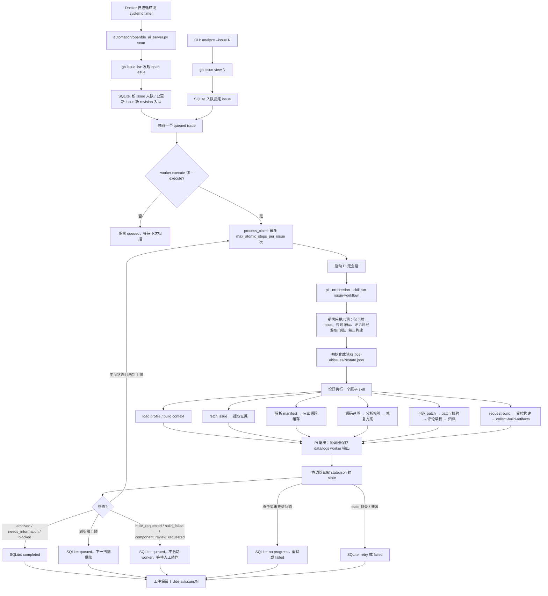

# Server、Pi 与 Skills 执行流程

## 关键约束

- `run-issue-workflow` 每次 Pi 调用只允许推进一个原子 skill；连续推进由协调器的 `process_claim` 循环负责。
- SQLite 只管理队列、revision、重试和 worker 日志路径；事实、证据和 patch 不在 SQLite，全部在 issue 工件目录。
- `state.json` 只能使用字段 `state`；`archived`、`needs_information`、`blocked` 才能使队列项完成。`build_requested`、`build_failed` 与 `component_review_requested` 是等待态：协调器只入队等待人工动作（构建或组件确认），不启动 worker。
- 同一状态连续出现两次视为无进展：协调器按失败重试计数，避免空转烧满步骤上限。
- patch 唯一位置是 `.fde-ai/issues/<issue号>/patch/0001-<名称>.patch`，未构建前永久是未应用、未测试的建议；构建只可经 profile `build.helper` 授权的助手执行，构建后必须回滚补丁。
- Docker 扫描循环与 systemd timer 都调用 `scan`；`worker.execute=true` 才会进入 Pi 循环。
