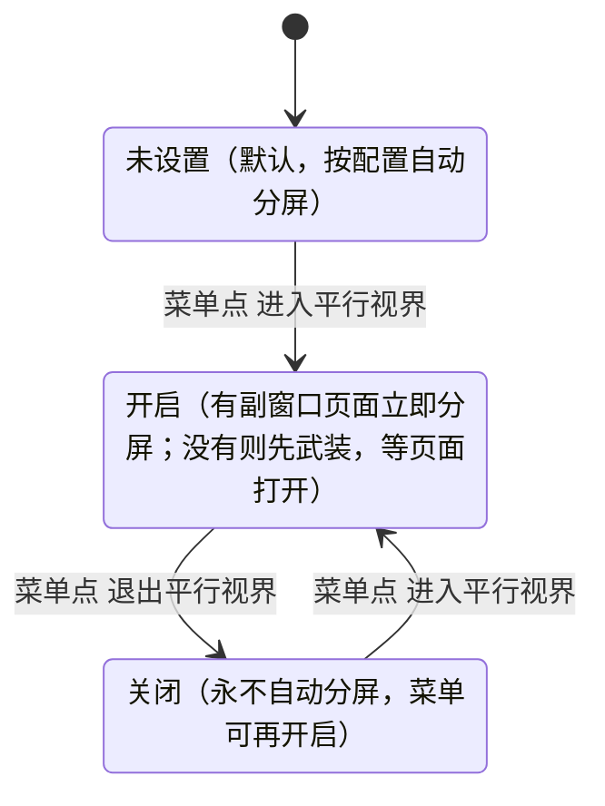
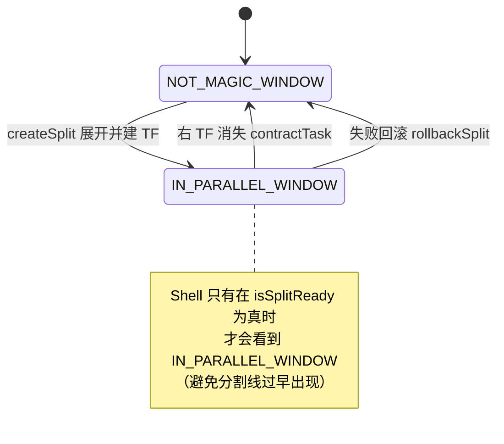
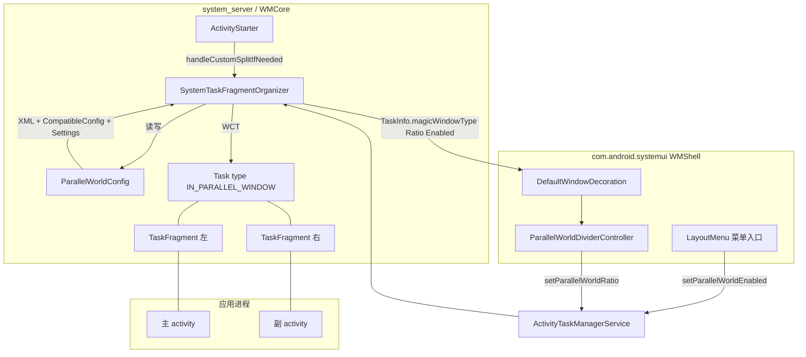
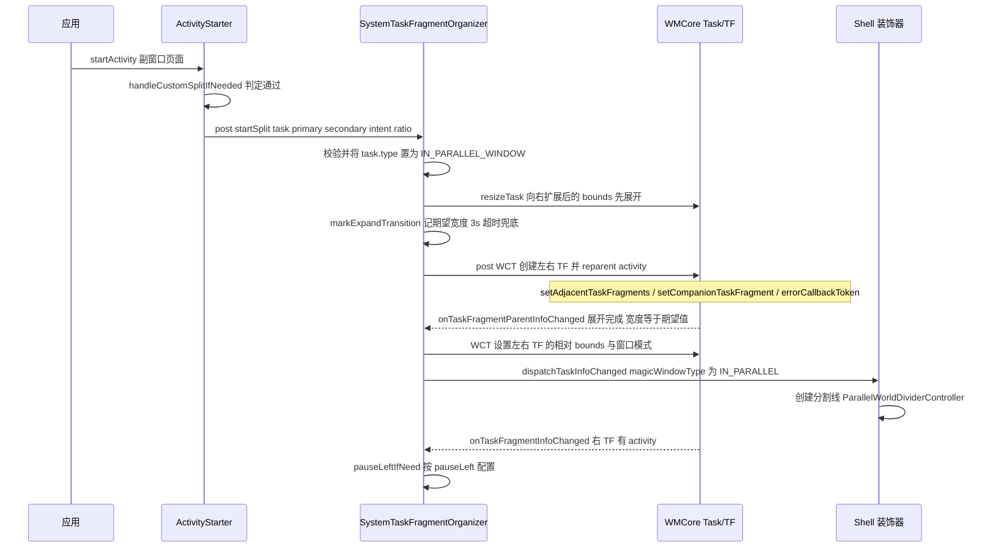
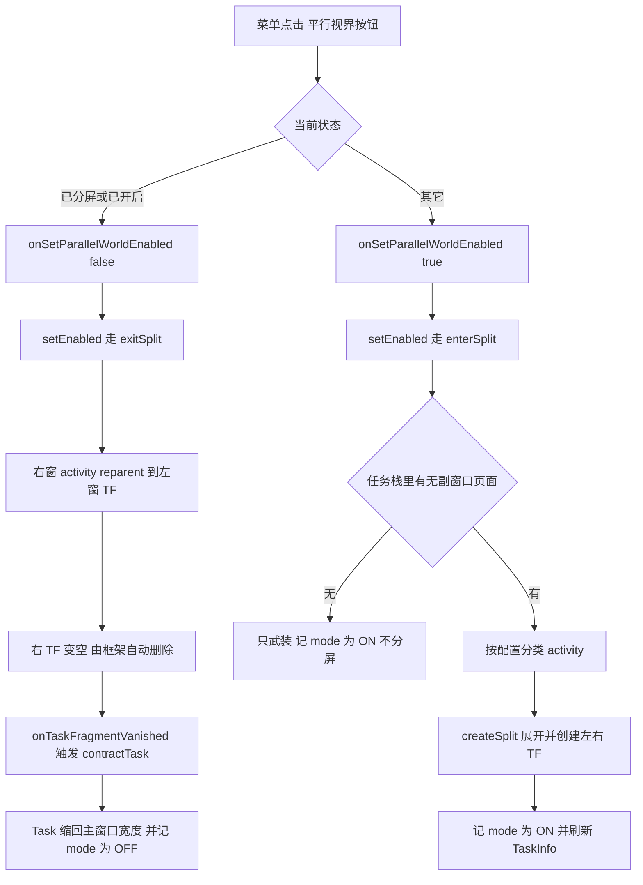
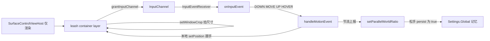

# OpenFDE桌面环境的平行视界-vibe coding版

> 本文记录在Android17桌面版本上，结合版本特性实现的平行视界功能，功能类似于14上的版本，做了一些功能改进，实现过程大量借助AI，实际上不止是vibe coding，也有vibe designing，也就是让AI辅助设计了功能，在以前的方案中，只是让AI帮忙分析了一下方案实现，这个版本70%的工作是AI做的，所以叫做vibe coding版。

| 项目 | 内容 |
| --- | --- |
| 功能名 | 平行视界（Parallel World，早期代号 Magic Window / 魔窗） |
| 适用平台 | Android 17（OpenFDE 桌面模式），framework/base + device 配置 |
| 参考实现 | Android 14 FDE `fde_14` 分支的 `SystemTaskFragmentOrganizer`（双 Task 方案已废弃，本实现为 TF 重写） |

功能演示：

<video src="C:\Users\huyan\Desktop\parallelworld.mp4"></video>

---

## 1. 功能概述

### 1.1 目标

在桌面模式（freeform 窗口）下，让**单窗口应用**具备"平行视界"能力：

- 应用的主页面固定在**左侧主窗口**，用户在应用内打开的其它页面出现在**右侧副窗口**；
- 两个窗口属于**同一个 Task**，共享任务生命周期、焦点、最近任务记录、窗口装饰（标题栏/最大化/关闭）；
- 应用**零改造**：不需要改 Manifest、不需要 launcher 配合、不需要传 Intent extra。

### 1.2 用户体验

```
┌────────────────────────────────────────────────────────────┐
│  ┌──────────────┬───────────────────────────────────────┐  │
│  │              │                                       │  │
│  │  主窗口       ║           副窗口                      │  │
│  │  (主 activity)│ 分割线      (应用内打开的其它页面)      │  │
│  │              ║                                       │  │
│  │              │                                       │  │
│  └──────────────┴───────────────────────────────────────┘  │
│         ↑ 保持原窗口宽度      ↑ 按比例(默认4:5)新增         │
│                                                            │
│  标题栏菜单： [进入平行视界] / [退出平行视界]  ← 开关        │
└────────────────────────────────────────────────────────────┘
```

- **自动进入**：从主窗口打开一个"副窗口页面"时自动分屏（窗口向右扩展，左窗尺寸不变）；
- **手动开关**：标题栏弹出菜单里的"平行视界"图标按钮，可进入/退出，**按应用记忆**；
- **分割线**：可鼠标拖拽调整两窗比例，松手后按应用记忆；
- **退出**：把副窗口的 activity 全部并回主窗口（同一个 Task 内合并成单窗）。

### 1.3 术语

| 术语 | 含义 |
| --- | --- |
| 主窗口（main window） | 左侧窗格，放应用的"主 activity"（配置里 `main` 声明的页面） |
| 副窗口（additional window） | 右侧窗格，放应用内打开的其它页面 |
| 主窗口页面 / 副窗口页面 | activity 级判定结果：`MAGIC_MAIN_WINDOW` / `MAGIC_ADDITIONAL_WINDOW` |
| 平行视界模式 | 用户级开关，按包名记忆：未设置 / 开（`MODE_ON`）/ 关（`MODE_OFF`） |
| TF | TaskFragment（Android 的窗口容器，Task 的子容器） |
| 展开（expand） | 分屏时把 Task 的 bounds 向右扩展 `left + right` 宽 |
| 收缩（contract） | 退出分屏时把 Task 缩回主窗口宽度 |

---

## 2. 设计思路

### 2.1 三种候选架构与取舍

| 方案 | 做法 | 结论 |
| --- | --- | --- |
| A. 双 Task 并排（A14 早期实现） | 同一个应用启动两个 Task，并排摆放，联动 move/resize | ❌ 最近任务是两条记录；焦点/装饰/移动/吸附都要人工联动；与桌面模式的拖拽逻辑冲突；代码量大 |
| B. 单 Task + 双 TaskFragment（**本实现**） | 一个 Task 内创建左右两个 TF，activity 分别 reparent 进去 | ✅ 任务生命周期、焦点、最近任务、窗口装饰天然共享；Shell 只需处理一条 task；与桌面模式解耦 |
| C. 应用内改造（如官方 ActivityEmbedding） | 应用自己用 SplitController/ActivityEmbedding | ❌ 需要逐个应用适配，第三方应用无法覆盖 |

**核心结论**：用 TF 把"分屏"做成 **Task 内部布局问题**，而不是"两个窗口的协同问题"。

### 2.2 判定放在 system_server

A14 的做法是 launcher 在 Intent 里传 `extraFDE`，客户端可伪造、且通知栏/分享/最近任务等入口会漏传。本实现把全部判定搬到系统服务端：

- **谁参与**：包名在 device 配置 `magic_config.xml` 里 → 参与；否则不参与；
- **谁是主/副窗口页面**：activity 简单类名命中 `main` 列表 → 主窗口页面；否则（且未被 `exclude`）→ 副窗口页面；
- **是否分屏**：全局开关 + 用户模式（`MODE_OFF` 不分屏）。

应用侧、launcher 侧都不需要任何改动，也无法绕过。

### 2.3 配置分层与优先级

| 层 | 位置 | 内容 | 谁来改 |
| --- | --- | --- | --- |
| 设备配置 | `/system/magicwindow_config/magic_config.xml` | 参与应用、主 activity、exclude 页、pauseLeft | 集成/产品 |
| 框架默认 | `core/res/res/raw/comp_config_value.xml`（CompatibleConfig `configMagicWindow`） | 每个应用的默认比例，如 `{"ratio":"4:5"}` | 集成 |
| 运行期记忆 | `Settings.Global` | `parallel_world_ratio_<pkg>`（用户拖拽的比例）、`parallel_world_mode_<pkg>`（开关：0/1/2） | 用户操作 |
| 全局开关 | 系统属性 `persist.sys.fde.parallel_world` | 整个功能开/关 | 调试 |

比例优先级：**用户拖拽值 > CompatibleConfig > 默认 4:5**。

### 2.4 状态模型

**应用级模式状态机**（`parallel_world_mode_<pkg>`）：



**任务级状态**（`Task.type` + Shell 可见的 `TaskInfo.magicWindowType`）：



---

## 3. 总体架构

### 3.1 模块与关键类

| 层 | 类/文件 | 职责 |
| --- | --- | --- |
| 配置 | `services/.../wm/ParallelWorldConfig.java` | 解析 XML、判定主/副窗口页面、比例优先级、模式记忆、dumpsys |
| 服务端核心 | `services/.../wm/SystemTaskFragmentOrganizer.java` | 分屏/退出/合并/比例更新/TF 生命周期/异常回滚 |
| 触发 | `services/.../wm/ActivityStarter.java` | 自动分屏触发条件（主窗口打开副窗口页面） |
| API | `core/java/android/app/IActivityTaskManager.aidl` | `setParallelWorldEnabled` / `setParallelWorldRatio` |
| API 实现 | `services/.../wm/ActivityTaskManagerService.java` | 权限校验 + 转调 organizer + `dumpsys activity parallel` |
| 状态上报 | `services/.../wm/Task.java` | `fillTaskInfo` 上报 `magicWindowType/Ratio/Enabled` |
| 兼容 | `services/.../wm/LaunchParamsPersister.java` | 不持久化 IN_PARALLEL 的展开 bounds |
| 权限 | `services/.../wm/WindowOrganizerController.java` | 允许 system organizer 跨应用建 TF |
| 暂停 | `services/.../wm/ActivityRecord.java` | `pauseActivityLockedOnly()`（微信兼容） |
| Shell 入口 | `libs/.../windowdecor/LayoutMenu.kt` | 菜单按钮（图标 + 动态文案 + 高亮） |
| Shell 动作 | `WindowDecorationActions.kt` / `DesktopModeWindowDecorViewModel.java` | 调 AIDL |
| Shell 分割线 | `ParallelWorldDividerController.kt` | 渲染 + 输入 + 拖拽比例 + 持久化 |
| Shell 装饰 | `DefaultWindowDecoration.kt`（生效）/ `DesktopModeWindowDecoration.java` / `CaptionWindowDecoration.java`（fallback） | 创建/更新/销毁分割线 |

### 3.2 组件关系



### 3.3 两条主链路

```
① 自动分屏（应用行为驱动）
   用户点应用内链接 → ActivityStarter.executeRequest
     → handleCustomSplitIfNeeded() → organizer.startSplit() → createSplit()

② 手动开关（用户操作驱动）
   标题栏菜单 → WindowDecorationActions.onSetParallelWorldEnabled
     → IActivityTaskManager.setParallelWorldEnabled
       → organizer.setEnabled() → enterSplit() / exitSplit()
```

---

## 4. 实现原理

### 4.1 配置与判定

**XML 解析**（`ParallelWorldConfig.load()`）：

```xml
<!-- /system/magicwindow_config/magic_config.xml -->
<packages>
    <!-- main 支持 "/" 分隔多个主 activity -->
    <package packagename="com.sina.weibo" main="VisitorMainTabActivity/MainTabActivity" />
    <!-- exclude：该页面既不算主窗口页面，也不算副窗口页面（不进分屏判定） -->
    <!-- pauseLeft：分屏后暂停主窗口（个别应用需要） -->
    <package packagename="com.tencent.mm" main="LauncherUI"
             exclude="LoginSelectUI" pauseLeft="true" />
</packages>
```

**判定函数**（核心只有十几行）：

```java
public int getMagicWindowType(String packageName, String activity) {
    if (!isEnabled() || TextUtils.isEmpty(packageName) || TextUtils.isEmpty(activity)) {
        return Task.NOT_MAGIC_WINDOW;
    }
    final PackageConfig config;
    synchronized (mPackages) {
        config = mPackages.get(packageName);
    }
    if (config == null) {
        return Task.NOT_MAGIC_WINDOW;          // 未配置的包 → 不参与
    }
    final String simpleName = toSimpleClassName(activity);
    if (config.excludedActivities.contains(simpleName)) {
        return Task.NOT_MAGIC_WINDOW;          // exclude 页（如微信登录页）
    }
    return config.mainActivities.contains(simpleName)
            ? Task.MAGIC_MAIN_WINDOW : Task.MAGIC_ADDITIONAL_WINDOW;
}
```

**比例优先级**：

```java
public float getSplitRatio(Context context, String packageName) {
    if (!isEnabled() || TextUtils.isEmpty(packageName)) return 0f;
    synchronized (mPackages) {
        if (!mPackages.containsKey(packageName)) return 0f;   // 未配置 → 0 表示"不参与"
    }
    final float userRatio = getUserRatio(context, packageName);   // ① 用户拖拽值
    if (userRatio > 0f) return userRatio;
    final String json = CompatibleConfig.queryStringValueData(context, KEY_RATIO, packageName);
    if (TextUtils.isEmpty(json)) return DEFAULT_PANE_RATIO;       // ③ 默认 4:5
    return parseRatio(json);                                      // ② 兼容性配置
}
```

**模式记忆**（按包名，`Settings.Global`）：

```java
public static final int MODE_UNSET = 0;   // 默认：按配置自动分屏
public static final int MODE_ON    = 1;   // 用户开：有副窗口页立即分屏
public static final int MODE_OFF   = 2;   // 用户关：永不自动分屏

public boolean isAutoSplitEnabled(Context context, String packageName) {
    return isEnabled() && getUserMode(context, packageName) != MODE_OFF;
}
```

### 4.2 自动分屏（启动路径）

#### 4.2.1 触发条件（`ActivityStarter.handleCustomSplitIfNeeded`）

```java
private void handleCustomSplitIfNeeded(ActivityRecord source, ActivityRecord r, Task task,
        int result) {
    if (r == null || task == null || source == null || source.info == null
            || r.info == null || r.intent == null) return;
    // 已在前台/已在栈顶的启动不算（避免重复触发）
    if (result == START_DELIVERED_TO_TOP || result == START_TASK_TO_FRONT) return;
    final ParallelWorldConfig config = ParallelWorldConfig.get();
    // ① 被启动的必须是"副窗口页面"
    if (!config.isAdditionalWindow(r.packageName, r.info.name)) return;
    // ② 用户关掉过 → 不自动分屏
    if (!config.isAutoSplitEnabled(mService.mContext, r.packageName)) return;
    // ③ 只有主窗口页面能打开副窗口
    if (config.getMagicWindowType(source.info.packageName, source.info.name)
            != MAGIC_MAIN_WINDOW) return;
    // ④ 必须已在同一个 Task（TF 方案要求）
    if (task != source.getTask() || task != r.getTask()) return;
    mService.mH.post(() -> triggerSplit(task, source, r, r.intent, mSplitRatio));
}
```

#### 4.2.2 分屏时序



#### 4.2.3 宽度计算与展开（`createSplit`）

```java
// 左窗保持应用原窗口宽度（用户感知：窗口向右"长"出副窗口）
int leftWidth = Math.max(originalWidth, minPrimaryWidth);
int rightWidth = Math.max(Math.round(leftWidth * ratio / (1 - ratio)), minSecondaryWidth);
final int maxExpandedWidth = getMaxExpandedWidth(task);
if (leftWidth + rightWidth > maxExpandedWidth) {
    rightWidth = maxExpandedWidth - leftWidth;
    if (rightWidth < minSecondaryWidth) {
        rollbackSplit(task);   // 副窗口无法满足最小尺寸 → 放弃分屏而不是塞进整个 Task
        return;
    }
}
final float effectiveRatio = (float) rightWidth / expandedWidth;
mSplitRatios.put(taskId, effectiveRatio);
mTaskBounds.put(taskId, taskBounds);      // 记录"分屏前"的 bounds，退出时用

// ① 若上次退出后残留了左窗 TF（它填满整个 Task），先把它钉回左窗宽度，
//    否则展开 Task 时主窗口会被拉伸，视觉上"展开两次"
final IBinder existingLeftToken = mLeftFragments.get(taskId);
if (existingLeftToken != null && mFragmentInfos.get(existingLeftToken) != null) {
    final WindowContainerTransaction pinWct = new WindowContainerTransaction();
    resizeTaskFragment(pinWct, existingLeftToken, new Rect(0, 0, leftWidth, height));
    applyTransaction(pinWct, 0, false);
}
// ② 先展开 Task，再建 TF（TF 用相对 bounds，展开完成前不更新容器）
mAtmService.resizeTask(taskId, newTaskBounds, 0);
markExpandTransition(taskId, expandedWidth);
```

#### 4.2.4 TF 创建（一个 WCT 完成）

```java
mAtmService.mH.post(() -> {
    final IBinder primaryTfToken = new Binder();
    final IBinder secondaryTfToken = new Binder();
    final WindowContainerTransaction wct = new WindowContainerTransaction();

    // 左 TF：owner = 主 activity token，初始相对 bounds = 左窗
    wct.createTaskFragment(new TaskFragmentCreationParams.Builder(
            getOrganizerToken(), primaryTfToken, primary.token)
            .setInitialRelativeBounds(leftBounds).build());
    for (ActivityRecord activity : leftActivities) {   // 自底向上，保证栈序
        wct.reparentActivityToTaskFragment(primaryTfToken, activity.token);
    }

    // 右 TF：与左 TF 配对（paired），有 activity 就 reparent，没有就启动
    wct.createTaskFragment(new TaskFragmentCreationParams.Builder(
            getOrganizerToken(), secondaryTfToken, primary.token)
            .setInitialRelativeBounds(rightBounds)
            .setPairedPrimaryFragmentToken(primaryTfToken).build());
    for (ActivityRecord activity : rightActivities) {
        wct.reparentActivityToTaskFragment(secondaryTfToken, activity.token);
    }
    if (rightActivities.isEmpty() && secondaryIntent != null) {
        wct.startActivityInTaskFragment(secondaryTfToken, primary.token, secondaryIntent, null);
    }
    wct.setAdjacentTaskFragments(primaryTfToken, secondaryTfToken, new TaskFragmentAdjacentParams());
    wct.setCompanionTaskFragment(primaryTfToken, secondaryTfToken, null /* toBeFinished */);
    wct.setErrorCallbackToken(registerErrorCallback(taskId));   // 失败回滚

    mLeftFragments.put(taskId, primaryTfToken);
    mRightFragments.put(taskId, secondaryTfToken);
    applyTransaction(wct, TASK_FRAGMENT_TRANSIT_OPEN, false);
});
```

#### 4.2.5 展开门控（避免"分割线出现在旧位置"）

```java
// 展开过渡期间：Task 宽度还没到位就不更新容器
void onTaskFragmentParentInfoChanged(WindowContainerTransaction wct, int taskId, ...) {
    if (shouldUpdateContainer(taskId, parentInfo)) {
        final Integer expected = mExpectedExpandedWidths.get(taskId);
        if (expected == null || taskBounds.width() == expected) {
            updateContainersInTask(wct, taskId, taskBounds, parentInfo.getConfiguration());
            if (expected != null) {
                mExpectedExpandedWidths.remove(taskId);
                dispatchTaskInfoChanged(taskId);   // 通知 Shell：可以显示分割线了
            }
        }
    }
}

// 容器更新：右 TF 不存在 → 左 TF 填满；否则按比例重排 + 切换窗口模式
void updateContainersInTask(...) {
    final IBinder rightToken = mRightFragments.get(taskId);
    if (rightToken == null) {
        resizeTaskFragment(wct, mLeftFragments.get(taskId), null);
        return;
    }
    final int leftWidth = Math.round(taskBounds.width() * (1 - ratio));
    resizeTaskFragment(wct, mLeftFragments.get(taskId), new Rect(0, 0, leftWidth, h));
    resizeTaskFragment(wct, rightToken, new Rect(leftWidth, 0, totalWidth, h));
    // FULLSCREEN → 两个 TF 都切 MULTI_WINDOW；FREEFORM → 保持 FREEFORM
}
```

### 4.3 手动开关（菜单入口）

#### 4.3.1 流程图



#### 4.3.2 进入（`enterSplit`）

```java
boolean enterSplit(int taskId) {
    // 1. 已分屏 → 直接成功；PIP / 全局关闭 → 拒绝
    if (task.type == Task.IN_PARALLEL_WINDOW || mRightFragments.get(taskId) != null) return true;
    if (task.inPinnedWindowingMode() || !config.isEnabled()) return false;

    // 2. 遍历任务栈（自底向上）按配置分类
    final List<ActivityRecord> leftActivities = new ArrayList<>();
    final List<ActivityRecord> rightActivities = new ArrayList<>();
    task.forAllActivities(activity -> {
        if (activity.finishing || activity.info == null) return;
        if (config.isAdditionalWindow(activity.packageName, activity.info.name)) {
            rightActivities.add(activity);       // 副窗口页面 → 右窗
        } else {
            leftActivities.add(activity);        // 主页面 / exclude 页 / 其它应用页 → 左窗
        }
    }, false /* traverseTopToBottom */);

    if (leftActivities.isEmpty()) return false;  // 没有主 activity，无法进入
    final float ratio = config.getSplitRatio(mAtmService.mContext, packageName);
    if (ratio <= 0f) return false;               // 非平行视界应用

    // 3. 还没有副窗口页面 → 只"武装"（记住开关），等自动分屏接管
    if (rightActivities.isEmpty()) {
        return true;
    }

    // 4. 真正分屏：复用自动分屏的完整流程
    task.type = Task.IN_PARALLEL_WINDOW;         // 先标记，避免展开 bounds 被持久化
    createSplit(taskId, task, leftActivities, rightActivities, null, ratio);
    return true;
}
```

#### 4.3.3 退出/合并（`exitSplit`）—— 本功能最关键的框架约束

> **框架行为**：`TaskFragment.remove()` 对**非空** TF 会调用 `finishIfPossible()` **结束里面所有 activity**。
> 所以退出分屏**不能直接删 TF**，必须先把 activity 搬出去。

```java
void exitSplit(int taskId) {
    final IBinder leftToken = mLeftFragments.get(taskId);
    final IBinder rightToken = mRightFragments.get(taskId);
    final TaskFragmentInfo rightInfo = mFragmentInfos.get(rightToken);
    if (leftToken == null || rightToken == null || rightInfo == null) return;

    final List<IBinder> activities = rightInfo.getActivities();
    if (activities == null || activities.isEmpty()) return;   // 右窗已空，框架会回收

    // 把右窗 activity 全部搬进左窗 TF（reparent 不会 finish activity）
    final WindowContainerTransaction wct = new WindowContainerTransaction();
    for (IBinder activityToken : activities) {
        wct.reparentActivityToTaskFragment(leftToken, activityToken);
    }
    applyTransaction(wct, TASK_FRAGMENT_TRANSIT_CLOSE, false);
    // 后续：右 TF 变空 → onTaskFragmentInfoChanged 触发 delete → onTaskFragmentVanished
    //       → contractTask() 把 Task 缩回主窗口宽度、task.type 复位
}
```

```java
/** 右 TF 消失后的收缩（onTaskFragmentVanished 调用） */
private void contractTask(int taskId) {
    final Rect taskBounds = mTaskBounds.get(taskId);
    final Float ratio = mSplitRatios.get(taskId);
    mAtmService.mH.post(() -> {
        final Rect newTaskBounds = new Rect(bounds.left, bounds.top,
                bounds.left + Math.round(bounds.width() * (1 - splitRatio)), bounds.bottom);
        task.type = Task.NOT_MAGIC_WINDOW;        // 先复位类型，再 resize（装饰器据此移除分割线）
        mAtmService.resizeTask(taskId, newTaskBounds, 0);
        mRightFragments.remove(taskId);           // 注意：保留 mLeftFragments
        mSplitRatios.remove(taskId);
        mExpectedExpandedWidths.remove(taskId);
        mSplittingActivities.remove(taskId);
        removeErrorCallback(taskId);
    });
}
```

> 注意 `contractTask` **保留左窗 TF 注册**：它填满整个 Task（`resizeTaskFragment(left, null)`），
> 这样 Task 后续被外部 resize 时左窗能自动跟随；代价是"Task 里永远有一个 TF"，
> 需要在下一次 `createSplit` 前先把它 pin 回左窗宽度（见 4.2.3）。

### 4.4 分割线（`ParallelWorldDividerController`）

#### 4.4.1 输入链路



> `grantInputChannel` 参数：`TYPE_APPLICATION` + `FLAG_NOT_FOCUSABLE` + `PRIVATE_FLAG_TRUSTED_OVERLAY`；
> `InputEventReceiver` 跑在 Shell 主线程（`wmshell.main`）。

关键点：**输入通道挂在 Task leash 上**（和窗口边缘拖拽同一条已验证通路），而不是 view host 上；view host 只负责渲染。

```kotlin
// 输入通道：在 leash 上申请，region 由 updateInputChannel 显式指定
private fun createInputChannel(): InputChannel? {
    val params = WindowInputChannelParams()
    params.displayId = taskInfo.displayId
    params.surface = leash
    params.clientToken = Binder()
    params.inputTransferToken = InputTransferToken()
    params.type = WindowManager.LayoutParams.TYPE_APPLICATION
    params.flags = WindowManager.LayoutParams.FLAG_NOT_FOCUSABLE
    params.privateFlags = WindowManager.LayoutParams.PRIVATE_FLAG_TRUSTED_OVERLAY
    params.inputHandleName = "ParallelWorldDivider"
    return session.grantInputChannel(params)
}

private fun updateInputRegion(width: Int, height: Int) {
    // 必须从 receiver 取 token：InputChannel 传给 InputEventReceiver 后 native 状态被转移
    val channelToken = inputEventReceiver?.token ?: return
    val params = WindowInputChannelParams()
    params.channelToken = channelToken
    params.surface = leash
    params.flags = WindowManager.LayoutParams.FLAG_NOT_FOCUSABLE
    params.privateFlags = WindowManager.LayoutParams.PRIVATE_FLAG_TRUSTED_OVERLAY
    params.region = Region(0, 0, width, height)
    session.updateInputChannel(params)
}
```

#### 4.4.2 拖拽换算（为什么必须用 rawX）

```kotlin
// leash 会随拖动移动：用局部 event.x 算增量会"自我抵消"（看起来只走一半）
MotionEvent.ACTION_MOVE -> {
    val boundaryX = dragStartBoundary + (event.rawX - dragStartRawX)   // 全局坐标
    val ratio = 1f - boundaryX / bounds.width()
    val clamped = min(MAX_RATIO, max(MIN_RATIO, ratio))                // 0.2 ~ 0.8
    lastBoundary = bounds.width() * (1 - clamped)
    transactionSupplier.get().setPosition(leash, lastBoundary - dividerSurfaceWidth / 2f, lastTop)
    // 16ms + 比例变化 ≥0.005 才上报，避免刷爆 binder / 应用重布局
    if (now - lastReportTime >= REPORT_INTERVAL_MS
        && abs(clamped - lastReportedRatio) >= RATIO_REPORT_THRESHOLD) {
        onRatioChanged.onRatioChanged(taskId, clamped, false /* persist */)
    }
}
// 松手：持久化（写入 Settings.Global）
MotionEvent.ACTION_UP, ACTION_CANCEL -> { endDrag() }
```

#### 4.4.3 渲染与尺寸

```kotlin
// 视觉：24dp 宽的 surface + 居中 4dp×48dp 圆角"手柄"
private val dividerSurfaceWidth = resources.getDimensionPixelSize(R.dimen.parallel_world_divider_width)

transactionSupplier.get()
    .reparent(leash, parentLeash)                                  // Task leash 可能被重建
    .setLayer(leash, TaskConstants.TASK_CHILD_LAYER_WINDOW_DECORATIONS)
    .setWindowCrop(leash, dividerSurfaceWidth, height)             // ★ 给容器层尺寸，否则输入窗口 frame 为空
    .setPosition(leash, boundary - dividerSurfaceWidth / 2f, captionHeight)
    .show(leash)
    .apply()
```

### 4.5 状态同步到 Shell

`Task.fillTaskInfo` 上报三个字段（都是 `@hide`，会随 TaskInfo 跨进程）：

```java
// fde start MAGIC WINDOW -> parallel world
final ParallelWorldConfig parallelWorldConfig = ParallelWorldConfig.get();
final boolean parallelWorldPackage = parallelWorldConfig.isEnabled()
        && top != null && top.info != null;
int magicWindowType = type;
if (magicWindowType == IN_PARALLEL_WINDOW) {
    if (mAtmService.mParallelVisionOrganizer != null
            && !mAtmService.mParallelVisionOrganizer.isSplitReady(mTaskId)) {
        // TF 还没建好/展开还没完成：不暴露给 Shell，避免分割线出现在旧位置
        magicWindowType = NOT_MAGIC_WINDOW;
    }
} else {
    // 未分屏：上报"栈顶 activity 的类型"，Shell 据此决定是否显示菜单入口
    magicWindowType = parallelWorldPackage
            ? parallelWorldConfig.getMagicWindowType(top.packageName, top.info.name)
            : NOT_MAGIC_WINDOW;
}
info.magicWindowType = magicWindowType;
info.magicWindowEnabled = parallelWorldPackage
        && parallelWorldConfig.getUserMode(mAtmService.mContext, top.packageName)
                == ParallelWorldConfig.MODE_ON;
info.magicWindowRatio = mAtmService.mParallelVisionOrganizer != null
        ? mAtmService.mParallelVisionOrganizer.getSplitRatio(mTaskId) : 0f;
// fde end
```

Shell 侧菜单入口（`LayoutMenu.kt`）：

```kotlin
// 开关状态 = 已分屏 或 用户手动开过（只有主 activity 时也能"关掉"）
val isParallelWorldTask = taskInfo.magicWindowType == TaskInfo.MAGIC_WINDOW_TYPE_IN_PARALLEL
val isParallelWorldOn = isParallelWorldTask || taskInfo.magicWindowEnabled
parallelWorldContainer.isVisible = taskInfo.magicWindowType != TaskInfo.MAGIC_WINDOW_TYPE_NONE
parallelWorldButton.isSelected = isParallelWorldOn
parallelWorldButton.background = style.parallelWorldOption.drawable     // 代码构建的 StateListDrawable
parallelWorldText.setText(
    if (isParallelWorldOn) R.string.parallel_world_exit_text
    else R.string.parallel_world_enter_text)
```

图标（两个方框、左小右大，与最大化/沉浸/全屏按钮同尺寸 108×60dp）：

```kotlin
private fun createParallelWorldIconDrawable(@ColorInt color: Int): Drawable {
    val width = (parallelWorldButtonWidth - 2 * parallelWorldFillPadding).toFloat()
    val height = (parallelWorldButtonHeight - 2 * parallelWorldFillPadding).toFloat()
    val panesWidth = width - parallelWorldPaneGap
    val leftPaneWidth = panesWidth * 4f / 9f      // 默认 4:5 → 左窗占 4/9
    return ShapeDrawable().apply {
        paint.color = color; paint.style = Paint.Style.FILL
        shape = PathShape(Path().apply {
            addRoundRect(RectF(0f, 0f, leftPaneWidth, height), radius, radius, Path.Direction.CCW)
            addRoundRect(RectF(leftPaneWidth + parallelWorldPaneGap, 0f, width, height),
                    radius, radius, Path.Direction.CCW)
        }, width, height)
    }
}
```

### 4.6 异常处理与自愈

| 场景 | 机制 |
| --- | --- |
| TF 创建/reparent 失败 | `errorCallbackToken` → `logTaskFragmentError()`：若分屏未成形 → 复位 `task.type` + `clearTaskState`，允许重试 |
| 展开卡住（Task 宽度一直不到 expected） | `markExpandTransition()` 3 秒超时：未成形 → 复位；已成形 → 主动 `dispatchTaskInfoChanged` 让分割线显示 |
| 最小尺寸不满足 | `createSplit` 里 `rollbackSplit(task)`（不把 activity 塞进整个 Task） |
| 右 TF 消失（用户关掉右窗页面） | `onTaskFragmentVanished` → `contractTask()` 收缩 + 复位 |
| 左 TF 消失（主窗口结束） | 结束右窗所有 activity + `clearTaskState` |
| PIP | `enterSplit` 拒绝；`shouldUpdateContainer` 在 PIP 期间不更新容器 |
| 展开后的 bounds 被持久化 | `LaunchParamsPersister` 对 `IN_PARALLEL_WINDOW` 直接返回 false |

---

## 5. 关键技术细节（踩坑记录）

### 5.1 框架约束类

| # | 现象 | 根因 | 解法 |
| --- | --- | --- | --- |
| 1 | 退出平行视界后**应用直接退出** | `TaskFragment.remove()` 对非空 TF 会 `finishIfPossible()` 结束 activity | 退出改为"把右窗 activity reparent 到左窗 TF"，让右 TF 变空后由框架回收 |
| 2 | 分割线显示正常但**鼠标无反应** | container layer 没有尺寸 → input window 的 `frame=[x,y][x,y]`、`touchableRegion=<empty>` | `setWindowCrop(leash, w, h)` 给容器层尺寸；同时把可触摸区加宽到 24dp |
| 3 | 取 token 时崩溃 `InputChannel$UninitializedException` | `InputEventReceiver` 构造时把 InputChannel 的 native 状态移走 | 用 `inputEventReceiver.getToken()`（DragResize 同款做法） |
| 4 | 拖动分割线"跟不上/走一半" | leash 随拖动移动，局部坐标增量自我抵消 | 改用 `event.rawX`（全局坐标） |
| 5 | 菜单点"进入"后**再 hover 最大化按钮弹框不出来** | `MaximizeButtonView.cancelHoverAnimation()` 里 `removeAllListeners()` 永久删掉动画结束回调，而动画对象是复用的 | 改为 `hoverAnimationCancelled` 标记，监听器保留 |
| 6 | 分屏后菜单经常打不开 | AOSP hover 守卫要求"任务聚焦"，分屏/沉浸态退出后焦点可能在别处；且 `relayout` 会在失焦时取消 hover | hover 不再要求聚焦（hover 事件只会到指针下窗口）；`relayout` 只在任务不可见时取消 |
| 7 | 微博退出分屏时"展开两下" | ① 残留左窗 TF 填满 Task，展开时被拉伸；② 应用退出沉浸态时 FDE 把 Task resize 回旧 bounds | ① 展开前 pin 左窗 TF 到左窗宽度；② `getExitDestinationBounds()` 对 IN_PARALLEL 任务返回当前 bounds |
| 8 | 主窗口被反复 resume/pause | 部分应用（微信）分屏后需要显式 pause 主窗口 | `pauseActivityLockedOnly()`（pause→resume 循环），配置 `pauseLeft="true"` 开启；另提供 `tf` 模式（`TaskFragment.startPausing`） |
| 9 | 跨应用建 TF 被拒绝 | `WindowOrganizerController` 校验 owner task 的 uid | 对 system organizer（SYSTEM_UID）放行 |

### 5.2 设计约束类

| # | 约束 | 说明 |
| --- | --- | --- |
| 10 | activity 只能"搬进 TF"，不能"搬回 Task" | 框架没有"reparent activity to task"的 organizer API，且删 TF 会结束 activity；所以退出后 Task 里保留一个填满的左窗 TF |
| 11 | `mSplittingActivities` 去重 | 同一次启动可能触发多次 `startSplit`，用"正在分屏的 activity"去重 |
| 12 | 展开过渡期间不更新容器 | 否则 TF 会按"未展开的 Task 宽度"计算，分割线位置错误 |
| 13 | 比例上报节流 | 拖动时 30~60Hz 的 WCT 会持续触发应用重布局，重应用掉帧；当前 16ms + 0.005 阈值 |
| 14 | 配置三处分散 | device XML（参与/主页面/exclude/pauseLeft）+ CompatibleConfig（比例）+ Settings（记忆），排查需 `dumpsys activity parallel` + `settings get global` |

---

## 6. 测试与调试

### 6.1 验证清单

| 场景 | 期望 |
| --- | --- |
| 配置内应用打开副窗口页面 | 自动分屏，左窗保持原宽度，窗口向右扩展 |
| 只有主 activity 时点"进入平行视界" | 只开开关（不展开），标签变"退出平行视界" |
| 开关打开后再打开副 activity | 自动进入分屏 |
| 已分屏时点"退出平行视界" | 右窗页面并回左窗，窗口收缩，应用不退出，activity 全在同一 Task |
| 退出后再次进入 | 无"展开两次"的视觉异常 |
| 分割线拖动 | 跟手、松手后比例被记住（`settings get global parallel_world_ratio_<pkg>`） |
| 开关记忆 | 重启应用后：开过的应用保持分屏行为；关过的应用不再自动分屏 |
| exclude 页面（微信登录页） | 不进副窗口（留在左窗） |
| 非配置应用 | 菜单里有"启用平行视界"入口，点击弹确认框；确认后当前页成为主窗口 |
| 多主 activity（微博） | `VisitorMainTabActivity` / `MainTabActivity` 都识别为主窗口页面 |
| 拖动分割线（第二批） | veil 跟手；松手后图标停留一会儿再淡出，露出的是最终尺寸 |
| 退出平行视界（第二批） | 无动画、右侧无空白占位、左上角出现"已退出平行视界"卡片 |

### 6.2 调试手段

> ⚠️ 子命令是 **`parallel`**（不是 parallelworld / magic），在 `ActivityTaskManagerService` 里注册：
> `public static final String DUMP_PARALLEL_WORLD_CMD = "parallel";`

```bash
# ① 配置 + 每个应用的 mode/ratio（子命令必须是 parallel）
adb shell dumpsys activity parallel

# 输出示例：
# ACTIVITY MANAGER PARALLEL WORLD (dumpsys activity parallel)
# Parallel world (FDE magic window):
#   enabled=true pauseMode=legacy
#   com.sina.weibo main=[VisitorMainTabActivity, MainTabActivity] exclude=[] pauseLeft=false mode=0 ratio=0.60909855
#   com.tencent.mm main=[LauncherUI] exclude=[LoginSelectUI] pauseLeft=true mode=1 ratio=0.5557711
# Parallel world organizer:
#   registered=true
#   task=26 left=android.os.Binder@... right=android.os.Binder@... ratio=0.60909855
#        bounds=Rect(33, 110 - 497, 877) expectedWidth=null secondary=... materialized=true
#
# 字段含义：
#   mode:    0=未设置(按配置自动分屏) 1=用户开启 2=用户关闭
#   ratio:   右窗占比（用户拖拽值 > CompatibleConfig > 默认 0.5556）
#   task 行: left/right = 左右 TF token，bounds = 分屏前的 Task bounds（退出时收缩用）
#            expectedWidth = 展开过渡期望宽度（null 表示已到位），materialized = TF 是否已就绪

# ② 记忆值（Settings.Global）
adb shell settings get global parallel_world_mode_com.sina.weibo     # 0/1/2
adb shell settings get global parallel_world_ratio_com.sina.weibo    # 0.0~1.0

# ③ 分割线输入窗口（应有 Embedded{ParallelWorldDivider}，frame/touchableRegion 非空）
adb shell dumpsys input | grep -A 3 ParallelWorldDivider

# ④ 组织者日志（分屏/退出/收缩/异常）
adb logcat -s SystemTaskFragmentOrganizer

# ⑤ 全局开关（关闭整个功能）
adb shell setprop persist.sys.fde.parallel_world false
```

### 6.3 调试日志开关

排查"菜单弹框"问题时加入的 20 条日志已**注释保留**，需要时取消注释即可（搜索 `ParallelWorld` 标签）：

| 文件 | 日志内容 |
| --- | --- |
| `DesktopModeTouchEventListener` | hover enter/exit 是否到达、菜单是否 active |
| `AppHeaderController` | create/closeLayoutMenu、canOpenLayoutMenu 为 false 的原因、resize 动画状态 |
| `AppHeaderViewHolder` / `FullscreenHeaderViewHolder` | hover 时任务是否聚焦（现在只打日志不拦截） |
| `MaximizeButtonView` | hover 动画 start/end/cancel、hoverDisabled |
| `DesktopModeWindowDecorViewModel` | resize 动画 start/end（`setAnimatingTaskResizeOrReposition`） |
| `DesktopTasksController` / `DesktopImmersiveController` | 沉浸态退出触发与目标 bounds |

---

## 7. 风险与隐患

### 7.1 功能风险

| 级别 | 风险 | 说明 / 建议 |
| --- | --- | --- |
| **高** | 外部 resize 与分屏几何冲突 | 沉浸态进出、用户拖拽窗口边缘、最大化/左右吸附都会改 Task bounds；`updateContainersInTask` 会跟随，但 `contractTask` 用的是分屏前的快照 `mTaskBounds`，可能出现"退出后宽度不对"。建议：收缩时以**当前** Task bounds 反推左窗宽度 |
| 中 | 任务栈分类边界未全覆盖 | 多主 activity、exclude 页、分享/选择器等**其它应用的页面**、PIP、系统 split-screen 下的行为需要补验证矩阵 |
| 中 | 开关状态异步不一致 | `TaskInfo` 经 organizer 异步下发，菜单标签可能短暂与实际不符 |
| 中 | reparent 的副作用 | activity 在 TF 间迁移可能触发 `onConfigurationChanged` 甚至重建（应用会闪一下） |
| 中 | `pauseLeft` 是兼容性 hack | `pauseActivityLockedOnly()` 只在微信验证过；`tf` 模式尚未实测 |
| 低 | 残留左窗 TF | 退出后 Task 里始终有一个 TF，可能与依赖"Task 直接持有 activity"的其它逻辑（快照/系统分屏/PIP）产生非预期交互 |
| 低 | 应用配合度 | `singleTask/singleInstance`、固定方向、`resizeableActivity=false`、特殊 affinity 的应用可能布局异常 |
| 低 | 无主 activity 时进入失败 | 仅打日志，UI 无提示（菜单入口仍显示） |

### 7.2 性能风险

| 风险 | 说明 | 建议 |
| --- | --- | --- |
| 拖动分割线的 WCT 频率 | 30~60Hz 的 `setRelativeBounds` 会持续触发应用重布局，重应用（微信/微博）掉帧 | 已有 16ms + 0.005 节流；可升级为"拖动只本地预览 + 松手一次性提交 + veil" |
| 分屏/退出的一次性开销 | 一次分屏 = 1 次 resize + 2 次 TF 创建 + N 次 reparent + 多次 relayout | 可考虑 TF 复用（退出时不销毁右 TF，只清空并隐藏） |
| 展开过渡空窗 | 展开期间 `updateContainersInTask` 被跳过（3s 超时兜底） | 观察极端情况下的白屏/错位 |
| 常驻资源 | 每个分屏任务多一个 surface + input channel + view host | 可接受；注意 `close()` 时释放 |
| pauseLeft 延迟 | `PAUSE_LEFT_DELAY_MS`（1s）期间主窗口仍活跃，可能焦点竞争 | 视应用表现调整 |

### 7.3 兼容与维护风险

1. **强依赖 framework 私有 API**：TaskFragment、WindowContainerTransaction、SurfaceControlViewHost、`@hide` 的 TaskInfo 字段。Android 版本升级属于"重写级适配"（本次 A14 → A17 即为重写）。
2. **TaskInfo 是跨进程 Parcelable**：字段增删必须同步修改 `writeToParcel/readFromParcel/copyFrom/equals/toString`，否则 FDE 插件/launcher 解析错位。
3. **配置分散三处**：排障成本高，建议补一个 `dumpsys activity parallel` 的完整输出说明文档。
4. **服务端判定与 launcher 无感知**：launcher 无法预知应用是否支持平行视界（如需 UI 提示需另开 API）。

---

## 8. 未来扩展

### 近期（低成本，1~2 天量级）
- 分割线体验：吸附预设比例（1:1 / 2:1 / 恢复默认 4:5）、双击合并、hover 高亮、更明显的视觉分割线
- 菜单入口状态更精确：区分"已开启未分屏"（当前只高亮）、补"关闭右侧"独立入口

### 中期（1~2 周量级）
- **布局方向扩展**：右主左副、上下分屏（TF 用相对 bounds，改动集中在比例计算与分割线轴向）
- **多窗格**：>2 个 TF（如主 + 两个副），需要重新设计比例模型与分割线数量
- **页面路由配置**：从"非主页面即副窗口"升级为显式白名单/黑名单（现有 `exclude` 已是雏形）
- **状态持久化**：重启/重开应用后恢复平行视界（现已有 mode/ratio 记忆，缺"启动即分屏"）
- **风险修复**：contract 用当前 bounds 反推；补全验证矩阵（分享/选择器/PIP/系统分屏/固定方向）

### 长期
- 与系统 split-screen、PIP 的互操作与迁移（进出平行视界时的过渡动画）
- 多显示器/跨屏拖拽
- 键盘快捷键/手势开关平行视界
- 性能方案升级：拖动 veil + 单次提交；TF 复用避免反复创建/销毁
- 与应用协商能力（如通过 CompatibleConfig 声明"该页面进副窗口"）

---

## 9. 第二批增强（已实现）

### 9.1 分割线视觉与更新时机
- 结构：全高 1dp 半透明线 + 居中 4×48dp 圆角手柄；颜色取自任务主题（`DecorThemeUtil`，线=outlineVariant、手柄=onSurface、高亮=primary）
- hover：线/手柄 alpha 0.5/0.7 → 1.0，颜色切到 primary
- 拖动中：线宽 1dp→4dp、手柄高 48→64dp，松手恢复
- **窗口尺寸变化时必须用 `viewHost.relayout(lp)` 而不是 `setView(view, lp)`**：`SurfaceControlViewHost.setView()` 在已经有 view 时是空操作（见 `SurfaceControlViewHostAdapter#updateView` 的写法），否则最大化/全屏后分割线长度和手柄位置会停留在第一次的尺寸
- **`updateParallelWorldDivider(taskInfo)` 必须挂在 9 参数 `relayout` 的末尾**（见 `DefaultWindowDecoration.relayout(taskInfo, startT, ...)`）：3 参数 `relayout`（`onTaskInfoChanged` 路径）内部会调用 9 参数那个，所以只放 9 参数即可覆盖两条路径。9 参数这条也是**过渡路径**（`DesktopModeWindowDecorViewModel#onTaskChanging` → 最大化/全屏/还原都走它）；如果只挂在 3 参数里，全屏/最大化后分割线要等到 caption 自动隐藏（约 3 秒）触发下一次 relayout 才更新，期间位置/长度都停在旧窗口模式
- 窗口尺寸变化时复位拖动状态：拖动过程中窗口被最大化/全屏/还原时 UP/CANCEL 可能收不到，不复位 `dragStartBoundary` 的话 `update()` 会一直用旧宽度算出的缓存边界（`lastBoundary`）
- 排查日志：`parallel world: split=.. ratio=.. caption=.. bounds=..`（每次 relayout）、`divider position: x=.. boundary=.. ratio=.. width=.. dragging=..`（位置变化时）、`divider geometry: WxH at x=.. y=..`（尺寸变化时）

### 9.2 拖动 veil（跟手）
- 问题：拖动时若实时 resize 两个 TF，应用重布局跟不上，视觉上"线在静态画面上滑"
- 方案（与桌面模式拖窗口一致，见 `VeiledTaskResizer`）：用两块 veil（纯色背景 + 应用图标）盖住左右窗，并移动 veil 与分割线；松手才把最终比例持久化提交（`persist=true`）
  - 拖动中按 32ms 节流发一次比例（`persist=false`），让应用在 veil 后面慢慢跟到接近最终尺寸，松手时的最后一次重布局就很小
  - 桌面模式拖动中完全不 resize、松手才 `setBounds`；两种都试过，节流版松手后更不容易看到缩放
- veil 收起时机：等任务上报的比例（`TaskInfo.magicWindowRatio`）等于松手时提交的比例后，再停 **600ms**（给应用重绘时间，图标停留久一点就看不到重布局）才淡出（200ms 淡出）；2000ms 超时兜底。停留时间可用 `persist.sys.fde.parallel_world.veil_hide_ms` 在设备上直接调（不用重新编译），重应用仍能看到缩放时加大即可
- 实现：`ParallelWorldDragVeil`（懒创建）+ 每块 veil 一个专用 container surface（`ResizeVeil.relayout` 会移动/裁剪它的 parentSurface，不能直接挂 task leash）
- 层级：`TASK_CHILD_LAYER_WINDOW_DECORATIONS - 1000`（app 之上、标题栏与分割线之下）

### 9.3 退出无动画
- `exitSplit()` 的过渡类型由 `TASK_FRAGMENT_TRANSIT_CLOSE` 改为 `0`：右窗直接消失
- 收缩阶段不能用 `ActivityTaskManagerService#resizeTask()`：shell transitions 开启时它会把 resize 包进 `TRANSIT_CHANGE` 过渡，导致左窗从全宽动画收缩；改为直接调 `Task.resize(bounds, 0, false)`（即框架在 transitions 关闭时走的那条路径），立即收缩无动画
- **退出后右侧空白占位**（移动一下窗口才消失）的根因：`Task#updateSurfaceSize` 对 **organized task**（桌面模式任务由 Shell 管理）直接 return，只在过渡（sync）期间才更新 task surface 的 crop；旧版走过渡时由过渡设置 crop，改成直接 resize 后没人更新 → task surface（窗口背景色 + 标题栏所在层）仍是旧宽度。修复：`contractTask` 里 resize 之后**立刻**用 `task.getSurfaceControl()` 设 `setWindowCrop(newTaskBounds)`（不能放在 Shell 的退出分支里：Shell 先收到 split=false 时 task 还没收缩，那时只能拿到旧 bounds）
- 退出是**两步**的：先 merge（Shell 看到 split=false，但 task 还是旧宽度）→ 副窗口 TF vanish → `contractTask`（task 才收缩）。所以 crop 必须跟收缩放在一起
- 副窗口 TF 还要**显式删除**：`TaskFragment#shouldRemoveSelfOnLastChildRemoval` 规定 organizer 创建的 TF 在最后一个 activity 被移走后不会自动删除，`exitSplit` 的两个分支都补了 `deleteTaskFragment`
- `contractTask` 的 `mH.post` 里必须 `synchronized (mAtmService.mGlobalLock)`：`Task.resize` / `dispatchTaskInfoChangedIfNeeded` / crop 都会碰 WMS 状态，不持锁会和动画线程的 `TaskOrganizerController#dispatchPendingEvents` 竞争，曾导致 system_server NPE 重启（`mTmpTaskInfo` 被并发置空）
- 进入分屏仍保留 `TASK_FRAGMENT_TRANSIT_OPEN` 与 `resizeTask()`（保留进入动画）

### 9.4 引导卡片（3 处）
- 复用同一个 `ParallelWorldGuide`（卡片文字、位置、停留时长每次 `show()` 传入），在 3 个时机显示：
  - **进入平行视界**：分割线旁，"平行视界已开启 / 拖动分割线可调整左右比例 / 标题栏菜单里可退出平行视界"，6 秒自动消失，拖动分割线立即消失
  - **退出平行视界**：任务左上角，"已退出平行视界 / 可在标题栏菜单里重新开启"，4 秒消失
  - **分割线**：鼠标悬停分割线时，"拖动分割线 / 左右拖动可调整两边宽度，松手后生效并记住比例"，3 秒消失
- **每种提示只显示一次**：`Settings.Global parallel_world_guide_shown` 存一个 bitmask（1=进入、2=退出、4=分割线），已经显示过的位不再显示，避免每次进出都弹卡片
- 调试属性 `persist.sys.fde.parallel_world.guide_always=1`：忽略 bitmask，每次都显示（用于反复查看/演示）
- 卡片是 `INPUT_FEATURE_NO_INPUT_CHANNEL` + `NOT_TOUCHABLE` 的非触控 overlay，不挡输入

### 9.5 用户自助配置
- 菜单入口对**所有**任务显示：已配置应用 → 原有开关；未配置应用 → 文案"启用平行视界" → 弹确认框
- 确认框（`ParallelWorldConfigureDialog`，view host + 按钮）：说明"当前页面会成为左侧主窗口 / 从它打开的其它页面显示在右侧 / 可随时关闭"，并**始终**提示"启用后当前页面会固定在左侧作为主窗口，请确认这是你希望常驻左侧的页面"（不再判断应用首页：很多应用首页是广告页，无法可靠识别）
- 卡片高度按内容测量（`measure()`），避免提示行变长后按钮被裁掉；弹窗在菜单关闭动画结束后（250ms）再创建，避免被正在关闭的菜单抢走焦点/输入
- 服务端：新增 `configureParallelWorldMain(taskId)`（AIDL）→ 取 task 栈顶 activity → 写入 `Settings.Global parallel_world_user_main_<pkg>` → `setEnabled(taskId, true)`
- 配置合并：device XML 优先；用户配置的包用默认比例 4:5，`dumpsys activity parallel` 以 `source=user` 标出
- 已知限制：v1 不支持移除/改配；确认框只在应用**未配置**时出现，已配置（用户配置层）的应用点菜单是直接进入/退出，不会再弹框（要重看弹窗可 `settings delete global parallel_world_user_main_<pkg>`）

### 9.6 新增资源与接口速查

| 名称 | 说明 |
| --- | --- |
| `boolean configureParallelWorldMain(int taskId)` | 配置当前页面为主窗口并启用（AIDL） |
| `parallel_world_user_main_<pkg>` | 用户配置的主 activity（Settings.Global） |
| `parallel_world_enable_text` / `parallel_world_configure_*` | 菜单入口与确认框文案（中英） |
| `parallel_world_guide_*`（title/drag/menu/exit_*/divider_*） | 3 处引导卡片文案（中英） |
| `parallel_world_divider_line_width` / `_line_drag_width` / `_handle_drag_height` | 分割线视觉尺寸 |

### 9.7 新增风险
| 风险 | 说明 |
| --- | --- |
| 用户配错主窗口 | 当前不支持改配，靠确认框提示规避；后续可在兼容性设置里管理 |
| veil 首次创建开销 | 首次拖动时创建 container + view host + 异步加载图标，首帧可能只显示背景色 |
| 无动画退出 | 合并后应用需按新宽度重布局，可能有 1 帧闪动 |
| veil 依赖比例回传 | 若任务信息未上报新比例（异常），veil 由 2000ms 超时隐藏，可能略早于应用重布局完成 |
| 拖动实时 resize 开销 | 拖动中每 32ms 一次 WCT + 应用重布局，重应用上可能掉帧（被 veil 遮住，但 CPU 有开销） |
| 引导卡片每次进入都显示 | 已去掉"仅首次"限制，频繁进出会反复弹卡片（6 秒自动消失，拖动即消失） |
| Shell 手动设 task crop | 退出平行视界时由 `SystemTaskFragmentOrganizer#contractTask` 设 crop 修正 organized task 的 task surface；若后续框架改为其他机制，需要同步调整 |
| 直接 resize 的持锁要求 | organizer 里对 WMS 状态的操作（resize/crop/dispatch）必须持 `mGlobalLock`，否则会和动画线程竞争导致 system_server 崩溃 |

---

## 10. 调试与验证手册

### 10.1 编译与刷机

```bash
# framework 或 Shell 改动都要重新编译
m services.core framework-minus-apex
# 必须刷 system.img（WindowManager-Shell.jar 在 system.img 里，只刷其他镜像不会生效）
```

建议验证顺序：**进入分屏 → 拖动分割线 → 松手 → 退出 → 再次进入**。

### 10.2 一分钟自检清单

| 项 | 操作 | 期望 |
| --- | --- | --- |
| 进入 | 打开副窗口页面 / 菜单"进入平行视界" | 窗口向右展开，分割线 + 引导卡片出现 |
| 拖动 | 按住分割线左右移动 | veil（纯色背景 + 应用图标）跟手，分割线变粗、高亮 |
| 松手 | 松开鼠标 | 图标停留一会儿后淡出；露出时内容就是最终尺寸，无缩放过程 |
| 退出 | 菜单"退出平行视界" | 右窗消失、窗口立即收窄（无动画）、右侧无空白占位、左上角出现"已退出"卡片 |
| 菜单 | 打开标题栏菜单 | 三态文案正确：启用平行视界 / 进入平行视界 / 退出平行视界 |

### 10.3 日志速查

```bash
# 平行视界相关日志（排障时只开这三个 tag）
adb logcat -s SystemTaskFragmentOrganizer DefaultWindowDecoration ParallelWorldDivider
```

| Tag | 关键行 | 含义 |
| --- | --- | --- |
| `SystemTaskFragmentOrganizer` | `createSplit: task=.. bounds=.. left=.. right=.. ratio=..` | 分屏：原 bounds、左右宽度、比例 |
| | `exitSplit: task=.. merge N activities` | 退出：把右窗 activity 并回左窗 |
| | `exitSplit: task=.. additional window is empty` | 退出时右窗已空，直接删 TF |
| | `onTaskFragmentInfoChanged: fragment has no activity, delete it` | 副窗口 TF 变空被删除 |
| | `onTaskFragmentVanished: task=.. token=..` | TF 被框架移除（`contractTask` 的触发点） |
| | `contractTask: task=.. bounds=..` | 收缩：用分屏前快照算出的新 Task bounds |
| | `contractTask: crop task surface to WxH` | 给 task surface 设 crop（见 9.3） |
| `DefaultWindowDecoration` | `parallel world: split=.. wasSplit=.. type=.. divider=.. ratio=.. caption=.. bounds=..` | 每次 relayout 的分屏状态；`type`：0=NOT_MAGIC_WINDOW，1=IN_PARALLEL |
| | `closeParallelWorldDivider: divider=..` | 关闭分割线/veil |
| `ParallelWorldDivider` | `endDrag: ratio=..` | 松手时的比例 |
| | `final ratio applied: .., veils hide in Nms` | 服务端比例已回传，N ms 后收 veil |
| | `veils hidden` | veil 已淡出 |
| | `divider position: x=.. boundary=.. ratio=.. width=.. dragging=..` | 分割线位置变化（窗口模式切换时应立刻出现，`width` 是新窗口宽度） |
| | `divider geometry: WxH at x=.. y=..` | 分割线尺寸变化（线长/手柄位置） |
| | `task resized while dragging, the drag is cancelled` | 拖动中窗口被改尺寸，拖动状态已复位 |
| | `divider has no input channel` | 分割线拿不到输入通道（拖动不了） |

正常退出时序（对照日志排查）：

```
exitSplit → onTaskFragmentInfoChanged(empty, delete) → onTaskFragmentVanished
  → contractTask(bounds + crop) → Shell relayout(split=false, bounds=新宽度)
  → closeParallelWorldDivider
```

### 10.4 属性与设置速查

| 键 | 类型 | 作用 | 用法 |
| --- | --- | --- | --- |
| `persist.sys.fde.parallel_world` | prop | 总开关（false 关闭整个功能） | `adb shell setprop persist.sys.fde.parallel_world false` |
| `persist.sys.fde.parallel_world.pause_mode` | prop | 左窗暂停方式：`legacy` / `tf` | `adb shell setprop persist.sys.fde.parallel_world.pause_mode tf` |
| `persist.sys.fde.parallel_world.veil_hide_ms` | prop | 松手后 veil 停留时间（ms，默认 600） | 松手仍能看到内容缩放时调大：`adb shell setprop persist.sys.fde.parallel_world.veil_hide_ms 1200` |
| `persist.sys.fde.parallel_world.guide_always` | prop | 忽略"已显示"标记，每次都弹引导卡片 | `adb shell setprop persist.sys.fde.parallel_world.guide_always 1` |
| `parallel_world_guide_shown` | Settings.Global | 引导卡片 bitmask（1=进入 2=退出 4=分割线） | 见 10.6（删除后 3 处提示会各再弹一次） |
| `parallel_world_mode_<pkg>` | Settings.Global | 0=未设置 1=用户开启 2=用户关闭 | `adb shell settings get global parallel_world_mode_com.sina.weibo` |
| `parallel_world_ratio_<pkg>` | Settings.Global | 用户拖动记住的比例 | `adb shell settings get global parallel_world_ratio_com.sina.weibo` |
| `parallel_world_user_main_<pkg>` | Settings.Global | 用户在菜单里配置的主 activity | 见 10.6（删掉可重新弹确认框） |

`dumpsys activity parallel`、分割线输入窗口、组织者 dump 的字段说明见 6.2。

### 10.5 常见问题排查

| 现象 | 根因 | 处理 |
| --- | --- | --- |
| 退出后右半留一块空白（移动窗口才消失） | organized task 的 task surface crop 没人更新；退出是两步（先 merge、后 contract），Shell 在第一步拿不到新 bounds | crop 必须放在 `contractTask` 里（9.3）；日志应出现 `contractTask: crop task surface to WxH` |
| 退出时窗口有收缩动画 | `ATMS.resizeTask` 会包一层 `TRANSIT_CHANGE` 过渡 | 用 `Task.resize` 直接收缩（9.3） |
| 退出后副窗口位置仍有空白占位 | organizer 创建的 TF 不会被框架自动删除（`shouldRemoveSelfOnLastChildRemoval`） | `exitSplit` 两个分支显式 `deleteTaskFragment`（9.3） |
| system_server 崩溃重启（`TaskOrganizerController` NPE） | organizer 在 `mH.post` 里操作 WMS 状态却没持 `mGlobalLock`，和动画线程的 pending event 派发竞争 | 所有 WMS 操作放进 `synchronized (mAtmService.mGlobalLock)`（9.3） |
| 松手后能看到内容缩放/延迟 | veil 收得太早，应用还没重绘完 | 调大 `persist.sys.fde.parallel_world.veil_hide_ms`（10.4） |
| 拖动时分割线不动 / 没有 hover 效果 | 输入通道没建好（容器没有 `setWindowCrop` 会导致 input region 为空） | 看 `ParallelWorldDivider` 日志；确认 `update()` 里调了 `setWindowCrop` |
| 最大化/全屏后分割线还是原来的长度、手柄位置不对 | 窗口尺寸变化时调了 `viewHost.setView()`，对已有 view 的 view host 是空操作 | 改用 `viewHost.relayout(lp)`（9.1）；日志 `divider geometry: WxH at x=.. y=..` 应随窗口变化出现 |
| 全屏/最大化后分割线位置不对，或要等约 3 秒才更新 | `updateParallelWorldDivider` 只挂在 3 参数 `relayout`（`onTaskInfoChanged`）上，过渡路径（9 参数，`onTaskChanging`）不更新它，直到 caption 自动隐藏触发下一次 relayout | 把调用放到 9 参数 `relayout` 末尾（9.1）；日志 `divider position: .. width=..` 应在模式切换当下出现（`width` 是新窗口宽度） |
| 菜单点"启用平行视界"不弹确认框 | 该应用已被用户配置过（`parallel_world_user_main_<pkg>` 有值），菜单直接进入/退出 | 删除该键或换未配置的应用；确认框只在未配置时出现 |
| 引导卡片不出现 | 进入/退出/悬停分割线三处；"已退出"卡片需要 `wasSplit=true` | 看 `parallel world: wasSplit=` 日志 |
| 悬停分割线没有提示卡片 | hover 事件没到分割线，或卡片被其他 surface 盖住 | 看 `ParallelWorldDivider` 是否有输入通道错误 |

### 10.6 复位与清理

```bash
# 让某个应用回到"未配置"（菜单重新出现确认弹窗）
adb shell settings delete global parallel_world_user_main_<pkg>
adb shell settings delete global parallel_world_mode_<pkg>
adb shell settings delete global parallel_world_ratio_<pkg>

# 让 3 处引导卡片各再弹一次
adb shell settings delete global parallel_world_guide_shown

# 列出所有平行视界相关的 Settings.Global
adb shell settings list global | grep parallel_world

# 运行期状态（分屏中/退出中、TF token、比例）
adb shell dumpsys activity parallel
```

---

## 附录 A：配置示例

**device 侧** `/system/magicwindow_config/magic_config.xml`：

```xml
<packages>
    <package packagename="com.sina.weibo" main="VisitorMainTabActivity/MainTabActivity" />
    <package packagename="com.tencent.mm" main="LauncherUI"
             exclude="LoginSelectUI" pauseLeft="true" />
</packages>
```

**框架侧** `comp_config_value.xml`：

```xml
<item isdel="false" key_code="configMagicWindow" update_date="2026-09-14">
    <package name="com.sina.weibo">
        <activity name="">{"ratio":"4:5"}</activity>
    </package>
</item>
```

## 附录 B：对外 API（`IActivityTaskManager`）

```aidl
/** 进入(enabled=true)/退出(false)平行视界，并按包名记忆；返回是否被接受 */
boolean setParallelWorldEnabled(int taskId, boolean enabled);

/** 更新分屏比例（右窗占比）；persist=true 时写入用户偏好（拖动松手） */
void setParallelWorldRatio(int taskId, float ratio, boolean persist);
```

## 附录 C：状态与常量速查

| 名称 | 值 | 含义 |
| --- | --- | --- |
| `Task.NOT_MAGIC_WINDOW` | 0 | 不参与 |
| `Task.MAGIC_MAIN_WINDOW` | 1 | 主窗口页面 |
| `Task.MAGIC_ADDITIONAL_WINDOW` | 2 | 副窗口页面 |
| `Task.IN_PARALLEL_WINDOW` | 3 | Task 处于分屏态 |
| `TaskInfo.MAGIC_WINDOW_TYPE_NONE` | 0 | Shell 用：无入口 |
| `TaskInfo.MAGIC_WINDOW_TYPE_IN_PARALLEL` | 3 | Shell 用：已分屏（高亮/退出） |
| `ParallelWorldConfig.MODE_UNSET/ON/OFF` | 0/1/2 | 用户模式 |
| `MIN_SPLIT_RATIO / MAX_SPLIT_RATIO` | 0.2 / 0.8 | 比例钳制范围 |
| `DEFAULT_SPLIT_RATIO`（organizer） | 0.5 | 未记录比例时的兜底 |
| `ParallelWorldDividerController.DEFAULT_RATIO` | 5/9 | Shell 侧默认比例（4:5） |
| `LIVE_RATIO_UPDATE_MS` | 32ms | 拖动中实时 resize 节流 |
| `VEIL_HIDE_DELAY_MS` | 600ms | 松手后 veil 停留时间（可用 `persist.sys.fde.parallel_world.veil_hide_ms` 覆盖） |
| `VEIL_HIDE_TIMEOUT_MS` | 2000ms | veil 兜底隐藏时间 |
| `GUIDE_ENTER/EXIT/DIVIDER_AUTO_HIDE_MS` | 6s / 4s / 3s | 三处引导卡片停留时间 |
| `EXPAND_TRANSITION_TIMEOUT_MS` | 3000ms | 展开自愈超时 |
| `PAUSE_LEFT_DELAY_MS` | 1000ms | 分屏后暂停主窗口的延迟 |
